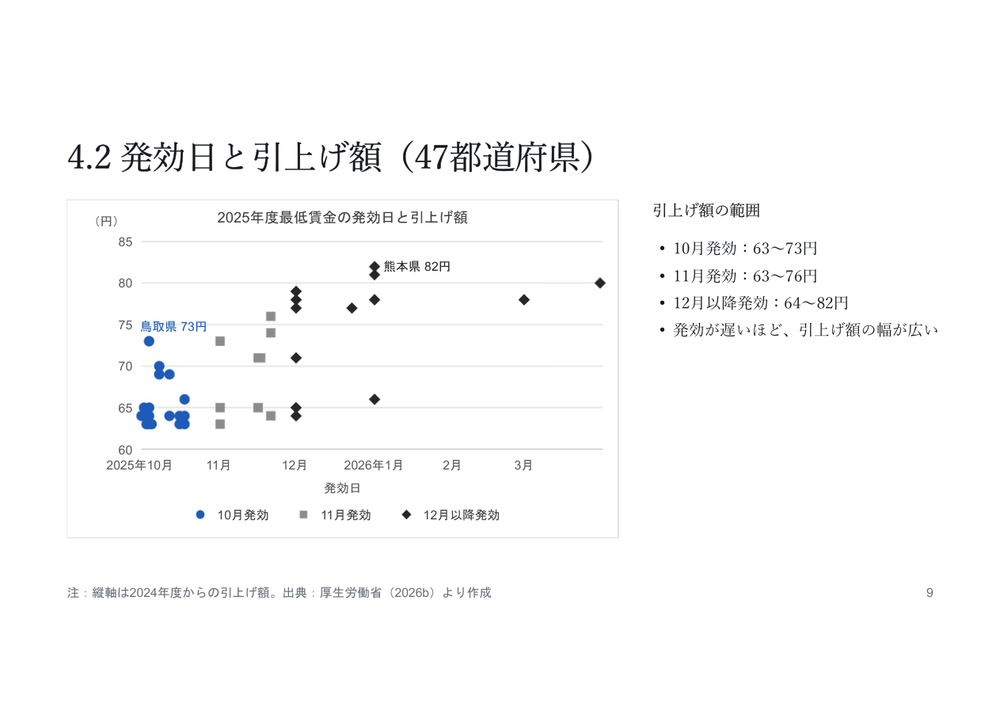
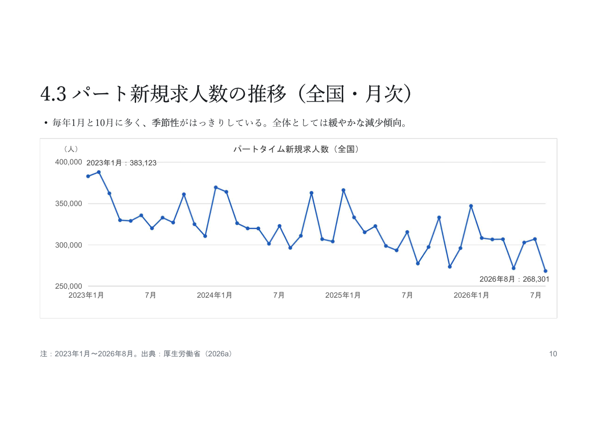
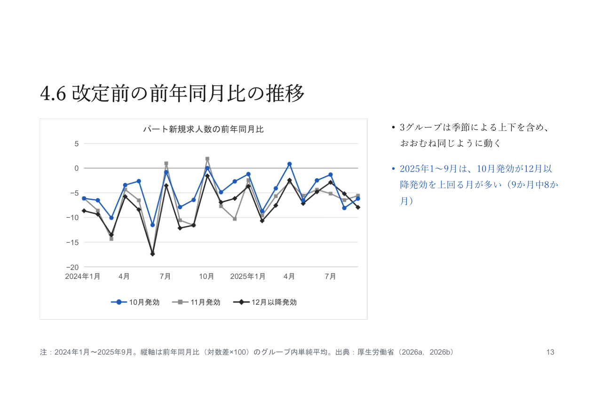

# 第二回发表 slides：逐页参考文本

- 发表日期：2026-10-28。
- 原件：[slides.pdf](slides.pdf)，用户提供的《課題2 データと仮説.pdf》，共15页。
- 本文件按原PDF的物理页码整理，清除排版换行、重建Markdown表格和链接，供检索及引用；不是原PPTX，也不是可重建原版式的Marp源稿。
- 保留已发表的日文表述、假说、数值与引用，不纳入发表后的模型、文献调查或修改建议。图表保留为原PDF页面图像，不从图片反推底层数据。
- PDF与讲稿是分别归档的两个版本，不自动用讲稿修正slides。例如第6页的「季節性を除く」和第13页的「おおむね同じように動く」均保留原文。需要判断当时实际说法时，同时核对[speech_reference.md](speech_reference.md)。版式及文字有疑义时以原件为准。

## 第1页｜最低賃金の発効時期とパート求人

SHEN MINGWEI・SUN SHAOHAN・WANG JING

## 第2页｜1.1 問いと比較の設定

- 問い：2025年度の最低賃金で、発効が早かった県と遅かった県では、パートの新規求人数の変化に違いがあったか。
- 比較：2025年11月に、10月発効の20県と12月以降発効の14県を比べる（11月発効の13県は除く）。
- 理由：11月は、10月発効の県では新しい最低賃金がすでに適用され、12月以降発効の県ではまだ適用されていない。
- 指標：パートタイムの新規求人数の前年同月比

出典：厚生労働省（2026b）

## 第3页｜2 仮説

- H0：2025年11月の前年同月比の差（10月発効－12月以降発効）は、改定前（2025年1～9月）の差と変わらない。
- H1：2025年11月の差は、改定前の差より小さくなる。つまり、10月発効グループの前年同月比が相対的に下がる。

指標：パートタイムの新規求人数の前年同月比（各グループ内の都道府県の単純平均）。H1は片側の仮説。

## 第4页｜2.1 仮説の根拠

- 太田・小前（2022）：ハローワークの月次統計で、パート新規求人と最低賃金に負の関係（ただし後半期は結果が弱い）。
- Kanayamaほか（2026）：改定直後にマッチング件数が減少。主な経路は求人掲載の減少と解釈。
- 改定前の差：2025年1～9月は、10月発効の前年同月比が12月以降発効を上回る月が多い（9か月中8か月）。この差を基準にして比べる。
- 注意：風神・阿部（2025）は求人広告の純増を報告しており、結果が一方向とは限らない。

出典：Ohta and Komae (2022)；Kanayama et al. (2026)；Kazekami and Abe (2025)

## 第5页｜3.1 使用するデータ

| 項目 | 求人のデータ | 最低賃金のデータ |
|---|---|---|
| 統計名 | 厚生労働省「一般職業紹介状況（職業安定業務統計）」 | 厚生労働省「地域別最低賃金改定状況」 |
| 使う変数 | 一般パートタイムの新規求人数（受理地） | 最低賃金額と発効年月日 |
| 期間 | 2023年1月〜2026年8月（月次） | 2024年度・2025年度 |
| 範囲 | 47都道府県×44か月 | 47都道府県 |
| 入手先 | e-Stat | 厚生労働省Webサイト |

新規求人数＝ハローワークが新たに受理した求人の採用予定人員。

（求人広告の件数や実際の採用人数ではなく、他の求人媒体も含まない）

出典：厚生労働省（2026a，2026b）。前年同月比の計算には2022年のデータも使用。

## 第6页｜3.2 分析用データの作り方

- パネル：47都道府県×44か月＝2,068観測
- 前年同月比：（log 今月の求人数－log 前年同月の求人数）×100（約%）。季節性を除くために使う。
- グループ：10月発効（20県）・11月発効（13県）・12月以降発効（14県）
- 引上げ額・率：2025年度の最低賃金－2024年度の最低賃金（率は2024年度に対する割合）

## 第7页｜4. 記述統計

4.1–4.2 2025年度の最低賃金改定

4.3–4.4 パート新規求人数の推移と分布

4.5–4.6 改定前の発効時期グループの比較

## 第8页｜4.1 発効時期グループ別の最低賃金

| グループ | 県数 | 2024年度 | 2025年度 | 引上げ額 | 引上げ率 | 発効日 |
|---|---:|---:|---:|---:|---:|---|
| 10月発効 | 20 | 1,025円 | 1,091円 | 65.2円 | 6.39% | 10/1〜10/18 |
| 11月発効 | 13 | 996円 | 1,064円 | 67.6円 | 6.82% | 11/1〜11/21 |
| 12月以降発効 | 14 | 962円 | 1,037円 | 74.8円 | 7.78% | 12/1〜翌3/31 |
| 全体 | 47 | 998円 | 1,067円 | 68.7円 | 6.92% | — |

- 発効が遅いグループほど、最低賃金の水準が低く、引上げ率が高い。
- グループ間では、発効時期だけでなく引上げ幅も異なる。

注：最低賃金・引上げ額・引上げ率はグループ内の単純平均。出典：厚生労働省（2026b）より作成

## 第9页｜4.2 発効日と引上げ額（47都道府県）

図題：2025年度最低賃金の発効日と引上げ額。横軸：発効日。縦軸：引上げ額（円）。凡例：10月発効・11月発効・12月以降発効。

図中の注記：熊本県82円、鳥取県73円。

引上げ額の範囲：

- 10月発効：63～73円
- 11月発効：63～76円
- 12月以降発効：64～82円
- 発効が遅いほど、引上げ額の幅が広い

注：縦軸は2024年度からの引上げ額。出典：厚生労働省（2026b）より作成

## 第10页｜4.3 パート新規求人数の推移（全国・月次）

- 毎年1月と10月に多く、季節性がはっきりしている。全体としては緩やかな減少傾向。

図題：パートタイム新規求人数（全国）。縦軸：人。

図中の注記：2023年1月：383,123、2026年8月：268,301。

注：2023年1月〜2026年8月。出典：厚生労働省（2026a）

## 第11页｜4.4 都道府県×月パネルの分布

| 全期間 | 平均 | 標準偏差 | 最小 | 中央値 | 最大 |
|---|---:|---:|---:|---:|---:|
| 新規求人数（人） | 6,843 | 8,105 | 1,389 | 4,060 | 62,145 |
| 前年同月比 | −5.17 | 9.12 | −36.20 | −5.35 | 37.82 |

| 年別 | 月数 | 求人数（平均） | 求人数（中央値） | 前年同月比（平均） |
|---|---:|---:|---:|---:|
| 2023年 | 12 | 7,278 | 4,395 | −2.47 |
| 2024年 | 12 | 6,924 | 4,054 | −7.01 |
| 2025年 | 12 | 6,600 | 3,874 | −5.81 |
| 2026年（1〜8月） | 8 | 6,433 | 3,849 | −5.51 |

- 月平均の求人数は東京都が最多（約5.1万人）、鳥取県が最少（約1,800人）と、県による規模の差が大きい。

注：1都道府県・1か月あたりの値。前年同月比は対数差×100。出典：厚生労働省（2026a）

## 第12页｜4.5 改定前のグループの特徴（2025年4～9月）

| グループ | 県数 | 月平均求人数（平均） | 月平均求人数（中央値） | 前年同月比（平均） |
|---|---:|---:|---:|---:|
| 10月発効 | 20 | 9,253 | 5,159 | −3.94 |
| 11月発効 | 13 | 5,622 | 3,693 | −5.00 |
| 12月以降発効 | 14 | 3,051 | 2,839 | −5.06 |

- 10月発効には東京・大阪・愛知などの大都市が含まれ、求人の規模が大きい（中央値は12月以降発効の約1.8倍）
- 前年同月比：3グループとも近い（約－4～－5％）

注：各県の2025年4〜9月の平均を、グループ内でまとめた値。出典：厚生労働省（2026a，2026b）

## 第13页｜4.6 改定前の前年同月比の推移

図題：パート新規求人数の前年同月比。凡例：10月発効・11月発効・12月以降発効。

- 3グループは季節による上下を含め、おおむね同じように動く
- 2025年1～9月は、10月発効が12月以降発効を上回る月が多い（9か月中8か月）

注：2024年1月〜2025年9月。縦軸は前年同月比（対数差×100）のグループ内単純平均。出典：厚生労働省（2026a，2026b）

## 第14页｜5 まとめ

- 最低賃金：発効が遅いグループほど水準が低く、引上げ率が高い
- 求人数：季節性が強く、全体として緩やかに減少
- 改定前：グループの動きは似ているが、10月発効のほうが高い月が多い
- 仮説へ：改定前の差を基準に、2025年11月の差が小さくなるか（H1）を確かめる。

## 第15页｜参考文献・データ

厚生労働省（2026a）「一般職業紹介状況（職業安定業務統計）⾧期時系列表 第12表都道府県（受理地）別雇用形態別新規求人数」e-Stat（https://www.e-stat.go.jp/stat-search/file-download?statInfId=000040505323&fileKind=0，2026年10月26日取得）。

厚生労働省（2026b）「地域別最低賃金改定状況」（https://www.mhlw.go.jp/content/11200000/001756130.xlsx，2026年10月26日取得）。

Kanayama, H., S. Miyaji and S. Otani (2026) “Just After Minimum Wage Hikes: Short-Run Labor-Demand Response and Reallocation,” arXiv:2505.04555v3.

Kazekami, S. and M. Abe (2025) “Effects of minimum wage changes on labor demand: analysis using job postings data,” Applied Economics, published online 14 November 2025. https://doi.org/10.1080/00036846.2025.2579945

Ohta, S. and K. Komae (2022) “Vacancies, Job Seekers, and Minimum Wages: Evidence from Public Employment Placement Service Data,” Keio-IES Discussion Paper Series, DP2022-004, Institute for Economic Studies, Keio University.
