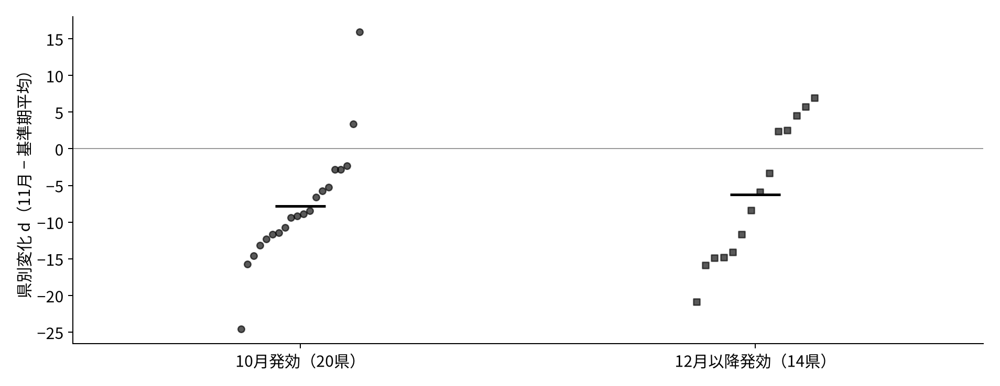

<!-- _class: title -->
# 最低賃金の発効時期とパート求人
## 企業の採用判断から、2025年11月の比較へ

課題3：モデルと検証方法 ／ 課題4：仮説の検証

2026年11月4日　基礎案
SHEN MINGWEI・SUN SHAOHAN・WANG JING

問い：早く発効した県では、パート求人の伸びが相対的に下がったか。 企業の希望雇用 → 新規求人 → 県別の差分、の順に考える。

<!--
今回の報告は、前回提示した11月の比較を、企業の意思決定から説明し直したものです。まず雇いたい人数を利潤から求め、その人数と求人がなぜ同じではないかを説明します。その後で、実際の県別データをどう差し引き、何が分かったかを示します。
-->

---
# 11月なら、新賃金の適用状態を分けられる

| 2025年度の発効時期 | 県数 | 2025年11月の法的な状態 |
|---|---:|---|
| 10月発効（早期：E） | 20 | 全月、新しい最低賃金 |
| 12月以降発効（後期：L） | 14 | 全月、旧最低賃金 |
| 11月発効 | 13 | 前回のルールどおり主比較から除外 |

- 同じ暦月・同じ統計の定義で比べ、各県を等しく扱う。
- ただし、発効日はランダムではなく、地域の条件も異なる。

早期／後期の2024年度賃金：1,025／962円、引上げ率：6.39／7.78%。 いずれも県の単純平均。発効時期「だけ」が違う二群ではない。

[6] 令和6・7年度欄。11月1日発効の県も、前回の群分けに従って除外する。

<!--
11月を選ぶ理由は、早期20県では新しい最低賃金、後期14県では旧最低賃金が月全体に適用されるためです。11月発効の13県は前回と同じ定義で外します。ただし、法的な適用状態を分けられることと、他の条件が等しいことは別です。遅い県ほど引上げ率が高く、単純な自然実験とは言えません。
-->

---
<!-- _class: equations -->
# 見るのは、ハローワークに届いた採用予定人員

- $V_{it}$：県 $i$・月 $t$ の一般パート新規求人数（人）。[5][8]
- 新たに受理した採用予定人員。広告件数・実際の採用・雇用者数とは違う。
- 受理地別であり、就業地や民間媒体の求人全体は分からない。

$$
y_{it}=100\bigl(\log V_{it}-\log V_{i,t-12}\bigr)
$$

$y_{it}$ は前年同月からの増減率の近似（対数差×100）。
毎年繰り返す季節性をある程度抑えるが、前年の政策影響も差し引く。

分析用パネル：2023年1月〜2026年8月、47県×44か月。 前年同月の値も使う。主比較に使うのは2025年1〜9月と11月、34県。

[5] 長期時系列第12表-3（一般パート・受理地）、[8] 用語(4)(10)。

<!--
例えば一つの求人票が3人を募集すれば、採用予定人員は3人です。3人が実際に採用されたことを表すわけではありません。県によって人数の規模が違い、月ごとの季節変動もあるため、同じ県の前年の同じ月からの変化を使います。ただし前年との比較だけでは、需要変化や前年の最低賃金改定を取り除けません。
-->

---
# 先行研究に対し、今回は何を追加するか

| 研究・データと比較方法 | 確認されたこと |
|---|---|
| 太田・小前（2022）[2]：公的紹介統計、2005〜19年の最低賃金パネル回帰 | パート求人と負の関係。後半期では弱い |
| 風神・阿部（2025）[3]：三大都市圏のパート広告、2019〜23年の賃金帯比較 | 求人広告の純増を報告 |
| Kanayamaほか（2026）[4]：2023年Timee、県×月×賃金帯のDID | 募集減が短期調整の主経路と解釈 |

今回は「2025年11月に、早期と後期の求人の伸びの差が変わったか」を追加して問う。

同じ統計・パート求人の分析は既にある。授業内の限定的な記述的拡張であり、 新しい因果識別や「初めて求人を調べた研究」とは主張しない。

[2] §3–4、Table 5；[3] 出版社オンライン版 §II–III；[4] arXiv v3 §4・5.2。

<!--
求人を見るという発想自体は新しくありません。最も近い太田・小前は同じ公的統計を既に分析しています。一方、民間広告では増加を報告する研究もあり、結果は一方向ではありません。私たちが多く問うのは、改定額の効果一般ではなく、前回示した発効時期の違いと同じ11月の短期変化です。方法が違うため、先行研究の係数をそのまま今回の予測値にはしません。
-->

---
<!-- _class: equations -->
# 一つの企業が、何人を雇いたいかを考える

店や工場は、増える売上と人件費を比べて人数を決める。
ここでは、価格・設備・生産性と1人当たり労働時間を固定する。

$$
w=\max\{w^0,m\}
$$

- $w$：実際に払う時給、$w^0$：最低賃金がなければ払う時給。
- $m$：法定最低賃金（いずれも円／時間）。
- $m>w^0$ なら最低賃金が拘束的で、改定が時給を押し上げる。

もともとの時給が新最低賃金より高ければ、この式では時給は変わらない。 企業自身の賃金設定、時間調整、将来の改定予期はここでは扱わない。

競争的な企業の労働需要：[1] §14.1。上の賃金の式・固定時間は本報告の追加仮定。

<!--
まず県ではなく一つの企業を考えます。企業は最低賃金を決めるのではなく、与えられた時給のもとで雇いたい人数を選びます。最低賃金が上がっても、その企業が既に十分高い時給を払っていれば、ここで想定する賃金費用の変化は起きません。したがって、全ての企業で同じ反応が出るというモデルではありません。
-->

---
<!-- _class: equations -->
# 利潤は、売上から賃金と固定費を引いたもの

生産量を $Q=A\bar K^{\alpha}N^{\beta}$ と置き、人数 $N\geq0$ を選ぶ。

$$
\max_{N\geq0}\;\pi(N)=pA\bar K^{\alpha}N^{\beta}-hwN-r\bar K
$$

- $N$：希望雇用者数（人）、$h$：1人の期間内労働時間（時間）。
- $p$：生産物価格（円／単位）、$A$：生産性、$\bar K$：固定設備。
- $hw$：1人当たり期間賃金（円）、$r\bar K$：固定設備費（円）。
- $0<\beta<1$：人数を増やすほど、追加1人による生産の増分は小さくなる。

$\pi$ は期間利潤、$\alpha$ は設備の生産への寄与を表す係数。退出は考えない。 べき関数は授業用の具体化であり、企業データから推定した関数ではない。

利潤最大化と限界生産物逓減：[1]。この関数形は本報告の仮定。

<!--
売上の部分は価格と生産量の積です。人件費は一人の労働時間、時給、人数の積なので、全て円で比較できます。設備費は今回の人数選択では変わらない固定費です。人数を増やすと売上は増えますが、設備が固定なので、追加一人の貢献は徐々に小さくなると置きます。この形により企業の最適人数を具体的に解けます。
-->

---
<!-- _class: equations -->
# 追加1人の売上と費用が等しい所で止める

正の人数を雇う場合（$N>0$）を考える。利潤を $N$ で微分し、一階条件（FOC）を求める。

$$
\pi'(N)=pA\bar K^{\alpha}\beta N^{\beta-1}-hw=0
$$

左の第1項は追加1人が生む売上、第2項はその人の期間賃金。
前者が大きければ増員、小さければ希望人数を減らす。[1]

$$
\pi''(N)=pA\bar K^{\alpha}\beta(\beta-1)N^{\beta-2}<0
$$

$0<\beta<1$ なので利潤は凹。FOCで得た人数は利潤の最大点になる。

[1] §14.1：賃金＝労働の限界生産物価値。時間固定のため、両辺を1人・1期間の円でそろえる。

<!--
一階条件は、数式上の微分を経済的な比較に言い換えたものです。一人増やしたときの追加売上が追加人件費より大きければ、その企業にはまだ増員する理由があります。等しくなった所が最適点です。二階条件が負であることは、そこで売上と費用が交わるだけでなく、利潤が最大になることを確認しています。次にこの等式を人数について解きます。
-->

---
<!-- _class: equations -->
# 時給が上がると、希望人数は減る

FOCを、人数だけが左辺に残るように整理する。

$$
\begin{aligned}
N^{1-\beta}&=\frac{pA\bar K^{\alpha}\beta}{hw},\\[0.5em]
N^*(w)&=\left(\frac{pA\bar K^{\alpha}\beta}{hw}\right)^{\frac{1}{1-\beta}}.
\end{aligned}
$$

$N^*$ は最適な希望雇用者数。分母の $w$ が大きいほど小さくなる。

$$
\frac{\partial N^*}{\partial w}=-\frac{N^*}{(1-\beta)w}<0
$$

資本・価格・生産性・労働時間を所与とした短期労働需要。 生産量まで固定した費用最小化ではなく、企業は生産量も変える。

[1] のFOCを本報告の関数形で解いたもの。拘束的な最低賃金の場合に賃金改定と結び付く。

<!--
最初の行は、一階条件の負の指数を反対側に移したものです。次に両辺を一引くベータの逆数乗にすると、最適人数が出ます。分母に時給があるので、時給が高くなるほど希望人数は減ります。ただし価格や設備などが一定という比較であり、需要が強くなった場合まで人数が減ると予測しているわけではありません。
-->

---
<!-- _class: equations -->
# 仮定値で、賃金上昇と人数の関係を確かめる

$\beta=0.5$、$h=160$ 時間、$pA\bar K^{\alpha}=3{,}200{,}000$ と仮定する。
他の条件を変えず、時給だけを上げる。

$$
N^*(w)=\left(\frac{1{,}600{,}000}{160w}\right)^2
$$

| 時給 $w$（円／時間） | 希望雇用者数 $N^*$（人） |
|---:|---:|
| 1,000 | 100.00 |
| 1,100 | 82.64 |

10%の時給上昇で、希望人数は約17.36%減るという計算例。

仮定値・推定ではない。小数の人数は連続近似。売上係数の単位は円／人の0.5乗。 この大きさを2025年の予測値に使わず、時給と人数の向きを確認する。

既存analysis.pyの desired_employment() で計算。仮定と計算結果：evidence/teaching_examples.json。

<!--
記号だけでは分かりにくいため、仮定値を代入します。千円のときは括弧の中が10なので、二乗して100人です。千百円にすると同じ計算で約82.64人になります。これは実際の企業を推定した数字でも、今回の県別結果を当てはめた数字でもありません。関数形と仮定によって反応の大きさは変わります。次は、この希望人数から新しい募集人数へ移ります。
-->

---
<!-- _class: equations -->
# 希望人数から、補充・追加の求人へ進む

前期の人数 $N_{-1}$ のうち、離職率 $s$ だけ辞めると仮定する。
残る人数を超える分だけ、新たに採用したい。

$$
H^d=\max\{N^*-(1-s)N_{-1},0\}
$$

$H^d$ は希望採用人数（人）。不足がなければ新規採用はゼロ。

$$
V^{\mathrm{HW}}=\frac{\theta}{f}H^d
$$

$V^{\mathrm{HW}}$：ハローワークでの新規募集人数（人）。
$f$：新規募集枠の期待充足割合、$\theta$：ハローワーク経由の募集割合。
必要な採用人数を充足割合で割り、その一部を公的経路で募集する。

$0\leq s,\theta\leq1$、$0<f\leq1$。解雇、繰越求人、募集費用を省いた本報告の補助式。 $f$ は「当月充足数÷当月新規求人数」をそのまま当てはめた値ではない。

雇用と採用・離職を区別する考え方：[2] 本文p.2。上の求人への式は本報告の追加仮定。

<!--
企業が100人を必要としていても、既に100人いれば100人分の求人を出す必要はありません。まず今いる人から離職者を除き、不足する人数だけを計算します。全ての募集枠が埋まるわけではないので、必要採用を期待充足割合で割ります。最後にハローワーク経由の割合を掛けます。これは理解のための簡単な式で、求人統計の全ての動きを表すモデルではありません。
-->

---
# 求人が減っても、雇用は同じ場合がある

100人の雇用を維持し、募集は全て埋まるとする。
全てハローワーク経由、つまり $f=\theta=1$ の仮定例。

|  | 離職率10% | 離職率5% |
|---|---:|---:|
| 前期の雇用者数 | 100人 | 100人 |
| 離職後に残る人数 | 90人 | 95人 |
| 維持のための補充求人 | 10人 | 5人 |
| 補充後の雇用者数 | 100人 | 100人 |

求人は半減しても、雇用はどちらも100人のまま。
充足割合や利用媒体の変化でも、公的経路の求人は変わる。

仮定値・推定ではない。analysis.pyの new_vacancies() で計算。雇用とフローの区別：[2][8]。

<!--
この例では希望雇用も前期雇用も100人に固定しています。10人辞めれば10人の補充が必要ですが、5人しか辞めなければ求人は5人で足ります。補充後の人数はどちらも同じです。したがって、求人の減少だけから希望雇用や実際の雇用が減ったと断定できません。先ほどの賃金の比較とは異なり、このページでは離職だけを変えています。
-->

---
# 条件を付けて、早期の求人が下がると予測する

最低賃金が拘束的な企業では、他の条件が同じなら、

**早い発効 → 11月の時給上昇 → 希望人数の減少 → 新規求人の減少**

- 最後の矢印には、前期雇用・離職率・充足割合・媒体割合が一定で、求人が正であることが必要。
- 仮説：11月の「早期 − 後期」の求人の伸びの差は、1〜9月の差より小さくなる。
- 一つの企業の予測を県平均で確かめる。企業別の拘束性や機序を直接測る検証ではない。

後期でも将来の賃金を予想して募集を減らす可能性がある。主モデルは予期を扱わない。 改定前に早期の伸びが高かったこと自体は、「差が縮むはず」という根拠ではない。

[1] の労働需要＋本報告の求人写像。比較月・群・負方向の仮説は10月28日発表を維持。

<!--
ここまでのモデルから、最低賃金が拘束的で他の条件が動かなければ、早い発効の地域で求人が相対的に下がるという方向が出ます。ただし一つの企業の比較静学と、異なる企業が集まる県同士の比較は同じではありません。後期でも予期があれば反応します。そこで、これは条件付きの仮説として県平均で検証し、企業の仕組みを識別したとは言わないようにします。
-->

---
<!-- _class: equations -->
# まず県内で、11月から基準期の平均を引く

$B$ は2025年1〜9月、Nov は2025年11月。
各県で前年同月比 $y$ を計算してから、県内の変化 $d_i$ を作る。

$$
\bar y_{i,B}=\frac{1}{9}\sum_{t\in B}y_{it},\qquad
d_i=y_{i,\mathrm{Nov}}-\bar y_{i,B}
$$

| 実データの例 | 1〜9月平均 | 11月 | 県内変化 $d_i$ |
|---|---:|---:|---:|
| 東京都（早期） | −1.636 | −8.259 | −6.623 |

$-8.259-(-1.636)\simeq-6.623$。11月は基準期より伸びが低い。
これを早期20県・後期14県のそれぞれで計算する。

単位は対数差×100の差（近似的な増減率のポイント差）。 東京都の変化は東京都の雇用減少率でも、全国の政策効果でもない。

results/county_changes.csv（主基準）。月を独立な政策単位とせず、各県に一つの変化を作る。

<!--
実際の操作は三段階です。まず同じ県の前年同月比を作り、次にその県の1月から9月の平均を取り、11月から引きます。東京都では約マイナス1.636からマイナス8.259になり、県内変化はマイナス6.623です。東京だけで結果を判断せず、この計算を34県で行います。その後で各県を一票として二群の平均を比べます。
-->

---
<!-- _class: equations -->
# 次に早期から後期を引くと、差分は−1.56

| 群内の県平均 | 基準期：1〜9月 | 11月 | 県内変化の平均 |
|---|---:|---:|---:|
| 早期20県（E） | −4.18 | −11.99 | −7.81 |
| 後期14県（L） | −5.80 | −12.06 | −6.25 |
| 早期 − 後期 | 1.62 | 0.07 | **−1.56** |

$$
\widehat\Delta=\bar d_{\mathrm E}-\bar d_{\mathrm L}
=-7.808656-(-6.253245)=-1.555410
$$

両群とも伸びが下がる中で、早期の下がり方が約1.56ポイント大きい。
「11月の差 − 基準期の差」でも同じ値になる。

東京都も小さい県も同じ重み。県平均であって、全国の求人総数の変化ではない。 $\widehat\Delta$ は実際に計算した差分。理論の人数や賃金弾力性とは単位が違う。

results/estimates.csv。表は表示桁で丸めているため、表示値同士の差に丸め誤差がある。

<!--
表の右端を見ると、早期の県内変化はマイナス7.81、後期はマイナス6.25です。早期から後期を引くとマイナス1.56になります。横に差し引いてから縦に引いても、下段のように群間差が1.62から0.07になったと考えても同じです。この値は雇用が1.56パーセント減ったという意味ではなく、求人の前年同月比の相対的な変化です。
-->

---
<!-- _class: chart -->
# 月ごとの線では、11月に二群が近づく

横軸：2025年の月。縦軸：前年同月比（対数差×100）の県平均。 実線・丸＝早期、破線・四角＝後期。11月はほぼ重なるが、毎月の差は一定ではない。

[5][6]より計算。灰色の8〜9月は公表後の予期に注意する期間。似た線でも並行トレンドの証明にはならない。

<!--
この図は元の月ごとの動きを示しています。人数の水準ではなく前年同月比なので、ゼロより下は前年の同じ月より求人が少ない状態です。早期と後期の平均は11月には近づいています。ただし、途中の差は一定ではなく、線の見た目だけで政策がなければ同じ動きをしたとは言えません。灰色の期間の予期を考え、後で基準を短くした結果も見ます。
-->

---
<!-- _class: chart -->
# 県ごとの変化には、大きなばらつきがある

横軸：早期／後期。縦軸：県内変化 $d_i$。点は各県、太い横線は群平均。 両群の点は広く重なる。平均との差だけでなく、このばらつきから不確実性を計算する。

主基準1〜9月、34県。横方向の小さなずらしは重なりを避ける表示であり、追加の変数ではない。

<!--
先ほどの折れ線は群平均でしたが、この図では各県を一つずつ見ます。縦軸は11月の前年同月比から基準期平均を引いた値で、ゼロより下ほど基準期より伸びが下がっています。横の小さなずれは点を見やすくするだけです。二群の平均に差はあっても、県ごとのばらつきは大きく、平均差がどの程度はっきりしているかは別に確認する必要があります。
-->

---
<!-- _class: equations -->
# 負の点推定だけでは、仮説を支持できない

$\Delta$ を検定対象の平均変化差とし、$H_0:\Delta\geq0$、$H_1:\Delta<0$。

$$
SE=\sqrt{\frac{s_{\mathrm E}^{2}}{20}+\frac{s_{\mathrm L}^{2}}{14}}=3.10
$$

$s_{\mathrm E}^{2},s_{\mathrm L}^{2}$ は各群の県内変化の不偏分散。
Welchの方法で、分散が二群で違ってもよい区間を作る。

| 点推定 | 95% Welch区間 | 負方向の片側p値 |
|---:|---:|---:|
| −1.56 | [−7.93, 4.82] | 0.310 |

区間はゼロをまたぎ、かなりの負の差も正の差も残る。
5%水準で負方向を支持できないが、影響ゼロや規模縮小の否定ではない。

両側p=0.620、Welch自由度25.50。県間の独立性等に依存する区間で、ランダム割付の因果区間ではない。

<!--
点推定は負で仮説の方向と一致しますが、標準誤差が約3.10と大きいため、区間はマイナス7.93からプラス4.82です。ゼロも含むので、5パーセント水準では負方向の仮説を支持しません。これは影響がない証明ではありませんし、両群に共通する求人減少や企業の規模縮小も否定しません。県はランダムに発効日を割り当てられたわけではなく、この区間は県間変動についての仮定にも依存します。
-->

---
<!-- _class: chart -->
# 8〜9月を基準から外しても、区間はゼロを含む

横軸：早期 − 後期の変化差。点＝推定値、横線＝各95%区間、破線＝ゼロ。 行ごとに基準期だけを変える。1〜7月では−2.18 [−8.85, 4.49]で、結論は明確にならない。

11月・34県・県等重みは固定。1〜7月も予期なしの保証ではない。4〜9月は前回記述表に対応する補足。多重比較未調整。

<!--
主基準は前回の発表どおり1月から9月です。ただし8月と9月には公表後の予期が含まれる可能性があるため、1月から7月に限った比較も示します。点推定はやや負に大きくなりますが、区間はやはりゼロを含みます。下の行は前回の記述表の期間に合わせた補足です。結果の符号を探して比較県や月を変えるのではなく、同じ比較で基準だけへの依存を確かめています。
-->

---
# 今回の比較だけでは、発効の遅さが求人を守るとは言えない

- 早期・後期差は点推定で縮小したが、負方向の仮説を確かめるには精度が足りない。
- 理論では賃金上昇が希望人数を減らす。ただし求人には離職・充足・媒体も効き、今回の集計データでは経路を区別できない。
- 時期の選択、改定幅、需要・産業構成、予期が群間で異なりうる。前年同月比でも因果効果は識別できない。
- 含意：求人と雇用を区別して読む必要がある。時期を遅らせる政策の推奨や、後の追い付きまでは導けない。

次に必要なのは、企業の実際の賃金・雇用・離職や媒体利用の情報。 モデルを豊かにするだけでは、同じ34県比較の証拠が強くなるわけではない。

<!--
結論は、今回のデータでは元の方向仮説を確かめきれない、というものです。理論は条件付きの負の反応を説明しますが、今回の県別求人の符号だけではその経路が働いたと確認できません。法的な発効の早さ以外にも違いがあり、受理地の求人だけを見ている点も残ります。政策提言を急ぐのではなく、求人と雇用を区別し、何を追加観測すれば説明を分けられるかを示すのが今回の含意です。
-->

---
<!-- _class: refs -->
# 参考文献・データ

[1] Shapiro, MacDonald and Greenlaw (2022), *Principles of Microeconomics 3e*, OpenStax, §14.1（労働需要）。[原文](https://openstax.org/books/principles-microeconomics-3e/pages/14-1-the-theory-of-labor-markets)

[2] Ohta and Komae (2022), “Vacancies, Job Seekers, and Minimum Wages,” Keio-IES DP2022-004, 2022年3月版、pp.2, 6–8, 12・Table 5。[PDF](https://ies.keio.ac.jp/upload/DPEN_7694_202203091453351.pdf)

[3] Kazekami and Abe (2025), “Effects of minimum wage changes on labor demand,” *Applied Economics*, 2025年11月14日オンライン公表版、§II–III。[DOI](https://doi.org/10.1080/00036846.2025.2579945)

[4] Kanayama, Miyaji and Otani (2026), “Just After Minimum Wage Hikes,” arXiv:2505.04555v3（本文表紙：2026年3月17日版）、§4・5.2。[PDF](https://arxiv.org/pdf/2505.04555v3)

[5] 厚生労働省「一般職業紹介状況」長期時系列第12表-3、一般パート・受理地（2026年10月26日取得版）。[Excel](https://www.e-stat.go.jp/stat-search/file-download?statInfId=000040505323&fileKind=0)

[6] 厚生労働省「地域別最低賃金改定状況」令和6・7年度欄（同日取得版）。[Excel](https://www.mhlw.go.jp/content/11200000/001756130.xlsx)

[8] 厚生労働省「用語の解説」(4)(9)–(12)（本報告保存抜粋）。[定義](https://www.mhlw.go.jp/toukei/list/114-1_yougo.html)

詳細な版・根拠箇所：sources.md ／ 導出：methods.md ／ 計算：analysis.py・analysis.ipynb

<!--
参照した版と該当箇所をまとめています。標準的な労働需要の根拠は教科書にあり、べき関数や求人への式は私たちが追加した仮定です。実証研究はデータも比較方法も違うので、結果を一つの符号にまとめずに参照しました。詳しい本文箇所、推導と再現用の計算は同じフォルダに保存しています。
-->

<!-- Machine-readable citation map.
## Sources

[1] https://openstax.org/books/principles-microeconomics-3e/pages/14-1-the-theory-of-labor-markets
[2] https://ies.keio.ac.jp/upload/DPEN_7694_202203091453351.pdf
[3] https://www.tandfonline.com/doi/full/10.1080/00036846.2025.2579945
[4] https://arxiv.org/pdf/2505.04555v3
[5] https://www.e-stat.go.jp/stat-search/file-download?statInfId=000040505323&fileKind=0
[6] https://www.mhlw.go.jp/content/11200000/001756130.xlsx
[8] https://www.mhlw.go.jp/toukei/list/114-1_yougo.html
-->
