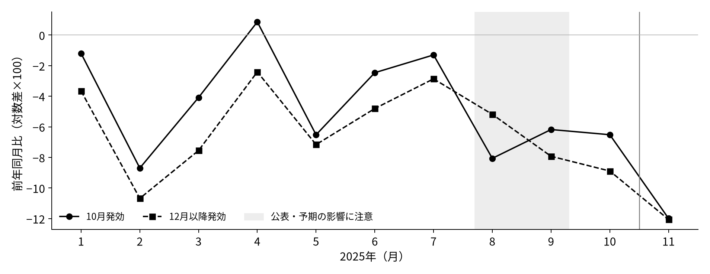
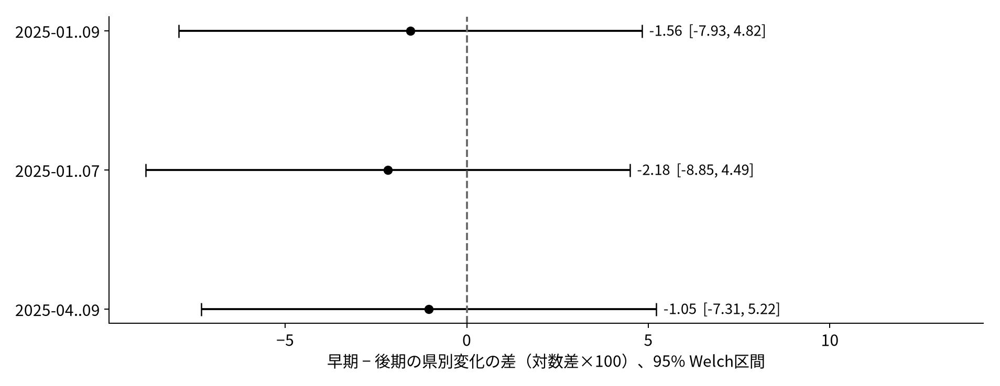

<!-- _class: title -->
# 最低賃金の発効時期とパート求人
## 2025年11月に、早期・後期の差は縮んだか

課題3：モデルと検証方法 ／ 課題4：仮説の検証

2026年11月4日　基礎案（課題4まで実行済み）
SHEN MINGWEI・SUN SHAOHAN・WANG JING

結論：点推定は差の縮小。ただし95%区間はゼロを含む。 既発表の比較を、県別差分と基準期間の変更で確かめる。

---
# 同じ11月に、異なる適用状態を比べる

| 2025年度の発効時期 | 県数 | 2025年11月の法的な適用状態 |
|---|---:|---|
| 10月発効（早期） | 20 | 新しい最低賃金が全月適用 |
| 12月以降発効（後期） | 14 | 旧最低賃金が全月適用 |
| 11月発効 | 13 | 既発表のルールどおり除外 |

- 一般パートの新規求人数（受理地、ハローワーク）を使う。
- 新規求人数は新たに受理した**採用予定人員**。広告件数でも実際の採用人数でもない。[8]
- 各県を等重みで比較する。賃金水準・改定率・産業構成は異なる。

データ：[5] 第12表-3；[6] 令和7年度欄。47県・全月連続・全国合計・内訳恒等式を再検算。

---
<!-- _class: equations -->
# 課題3：企業は希望する労働量を選ぶ

教科書の限界生産物条件を、固定資本のべき関数で具体化する。[1]

$$
\max_{N\geq 0}\;\left\{pA\bar K^{\alpha}N^{\beta}-hwN-r\bar K\right\}
$$

$0<\beta<1$、$w=\max\{w^0,m\}$ のもとで、一階条件と最適雇用は

$$
\begin{aligned}
pA\bar K^{\alpha}\beta N^{\beta-1} &= hw, \\[0.5em]
N^* &= \left(\frac{pA\bar K^{\alpha}\beta}{hw}\right)^{\!\frac{1}{1-\beta}}.
\end{aligned}
$$

- $N$：希望雇用者数、$h$：1人の労働時間（固定）、$m$：最低賃金。
- 資本・価格・生産性・時間を所与とした短期労働需要。
- 最低賃金が拘束的なら、$w$ の上昇で $N^*$ は下がる。

p：生産物価格、A：生産性、K：固定資本（所与）。 べき関数と賃金の式は本報告の仮定。生産量所与の費用最小化需要とは区別する。パラメータは推定しない。

[1] §14.1 “Demand for Labor in Perfectly Competitive Output Markets”。導出・二階条件・数値検算：methods.md。

---
<!-- _class: equations -->
# 希望雇用から、補充・追加の求人へ

離職後に残る人数を超える部分だけ、新たに募集すると仮定する。

$$
\begin{aligned}
H^d &= \bigl[N^*-(1-s)N_{-1}\bigr]_+, \\[0.65em]
V^{\mathrm{HW}} &= \frac{\theta}{f}\,H^d.
\end{aligned}
$$

s：離職率、f：新規募集枠の期待充足割合、θ：ハローワーク経由の割合。 既存雇用・s・f・θ が一定で求人が正なら、賃金上昇 → 希望雇用減 → 求人減。

- 例：100人を維持しても、離職が10人から5人なら補充求人は半減する。
- 充足の難しさや利用媒体でも求人は変わる。**求人減＝雇用減ではない。**

この式は本報告の補助的な写像。募集費用・繰越求人・将来の賃金予期は省略。 上の100人の例は仮定値であり、推定結果ではない。

雇用と採用・離職フローを区別する考え方：[2] 本文p.2（PDF p.4）。新規求人の定義：[8] (10)。

---
<!-- _class: equations -->
# 一つの方向仮説を、一県一票で検証する

$$
\begin{aligned}
y_{it} &= 100\bigl(\log V_{it}-\log V_{i,t-12}\bigr), \\[0.45em]
d_i &= y_{i,\mathrm{Nov}}-\bar y_{i,B}, \\[0.45em]
\Delta &= \bar d_{\mathrm{E}}-\bar d_{\mathrm{L}}.
\end{aligned}
$$

B：2025年1〜9月、Nov：2025年11月、E：早期20県、L：後期14県。

- 仮説：11月の「早期 − 後期」の差は、1〜9月の差より小さくなる。
- 検定：$H_0:\Delta\geq0$、$H_1:\Delta<0$。95% Welch区間と両側p値も示す。
- 34県の変化を比較し、県×月を独立観測として水増ししない。

モデルの予測は他の条件一定の場合。事前の差が正だったことだけでは、差の縮小は予測できない。区間は県間の独立性等を仮定する。

11月・20県対14県・1〜9月基準・負方向は、10月28日の発表から維持。

---
# 課題4：11月には、二群の平均がほぼ重なる

全て県内の前年同月比を計算した後の群内単純平均。 1〜9月の差は 1.62、11月の差は 0.07（対数差×100）。

[5][6] より再計算。灰色は8〜9月：公表後の予期もありうる期間。並行トレンド成立の証明ではない。

---
# 点推定は負だが、区間は広い

| 県別変化 $d_i$ の平均 | 値（対数差×100） |
|---|---:|
| 早期20県 | -7.81 |
| 後期14県 | -6.25 |
| 差 $\widehat\Delta$（早期 − 後期） | **-1.56** |
| 95% Welch区間 | **[-7.93, 4.82]** |

片側p値 0.310 ／ 両側p値 0.620 ／ Welch自由度 25.50

点推定では差が縮むが、負方向の仮説を5%水準で支持しない。 「差がない」と確定する結果でもない。県別変化の散布図はnotebookに収録。

results/estimates.csv。各群不偏分散を使ったWelch検定。群ダミーOLSの係数と差の一致を検算。

---
# 基準期間を変えても、明確な結論にはならない

どの基準でも点推定は負、95%区間はゼロを含む。 1〜7月に限定しても、予期が完全にないとは保証できない。

11月と34県を固定し、基準だけ変更。4〜9月は前回の記述表に対応する追加感度。区間は各々の未調整95%区間。

---
# 結論：元の仮説は、今回の比較では確かめきれない

- 11月の早期・後期差は点推定で縮小した。ただし不確実性が大きい。
- 最低賃金への負の反応は条件付き予測。需要・離職・充足・媒体選択を観測しておらず、機序は判別できない。
- 発効時期はランダムでない。同比は前年の政策影響も差し引く。受理地と就業地も一致するとは限らない。

本案の増分：新しい因果効果を主張せず、既発表の問いを実際に検定し、 モデルの成立条件と基準期間への依存を明示した。  太田・小前は同じ統計のパート求人を分析済み。[2] 求人広告で純増を報告する研究もある。[3] Timeeの短期分析もある。[4]「求人に注目すること」自体を新規性とはしない。

---
<!-- _class: refs -->
# 参考文献・データ（照合箇所）

[1] Shapiro, MacDonald and Greenlaw (2022), *Principles of Microeconomics 3e*, OpenStax, §14.1（労働需要・限界生産物条件）。[原文](https://openstax.org/books/principles-microeconomics-3e/pages/14-1-the-theory-of-labor-markets)

[2] Ohta and Komae (2022), “Vacancies, Job Seekers, and Minimum Wages,” Keio-IES DP2022-004, 本文pp.2, 6–8, 12／Table 5。主に同統計の先行研究との比較。[PDF](https://ies.keio.ac.jp/upload/DPEN_7694_202203091453351.pdf)

[3] Kazekami and Abe (2025), “Effects of minimum wage changes on labor demand,” *Applied Economics*, オンライン公表版, §II, §III。三大都市圏のパート求人広告。[DOI](https://doi.org/10.1080/00036846.2025.2579945)

[4] Kanayama, Miyaji and Otani (2026), “Just After Minimum Wage Hikes,” arXiv:2505.04555v3, §4, §5.2（PDF pp.19–21, 24–25）。Timeeの募集とマッチング。[PDF](https://arxiv.org/pdf/2505.04555v3)

[5] 厚生労働省「一般職業紹介状況」長期時系列第12表、一般パート・受理地。[Excel](https://www.e-stat.go.jp/stat-search/file-download?statInfId=000040505323&fileKind=0)　[6] 同「地域別最低賃金改定状況」令和6・7年度欄。[Excel](https://www.mhlw.go.jp/content/11200000/001756130.xlsx)

[8] 厚生労働省「用語の解説」(4), (9)–(12)。[定義](https://www.mhlw.go.jp/toukei/list/114-1_yougo.html)

文献の版・具体的な本文箇所・根拠の抜粋：sources.md / evidence/。 再現コード：analysis.py、実行済み：analysis.ipynb（ローカル実行、未公開リンクなし）。

<!-- Machine-readable mapping for the references displayed on slide 10.
## Sources

[1] https://openstax.org/books/principles-microeconomics-3e/pages/14-1-the-theory-of-labor-markets
[2] https://ies.keio.ac.jp/upload/DPEN_7694_202203091453351.pdf
[3] https://www.tandfonline.com/doi/full/10.1080/00036846.2025.2579945
[4] https://arxiv.org/pdf/2505.04555v3
[5] https://www.e-stat.go.jp/stat-search/file-download?statInfId=000040505323&fileKind=0
[6] https://www.mhlw.go.jp/content/11200000/001756130.xlsx
[8] https://www.mhlw.go.jp/toukei/list/114-1_yougo.html
-->
