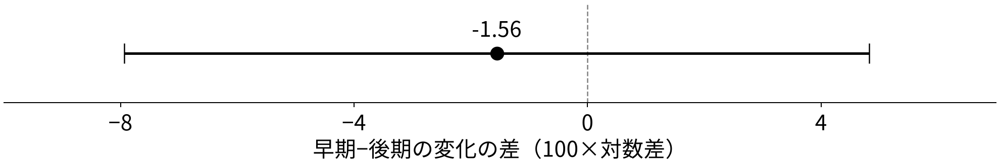

<!-- _class: title -->

# 最低賃金の発効時期と採用の構成

## パート求人だけが弱くなるのか、求人全体が縮むのか

2025年11月の早期20県・後期14県の比較に、
「規模」と「構成」を分けて読む視点を加える。

2026年11月4日　ミクロ経済学セッション　課題3・4 SHEN MINGWEI・SUN SHAOHAN・WANG JING

<!-- notes: 前回のパート求人の比較を出発点にします。今回はパート以外と合計も見ることで、求人全体が縮む場合と、求人の組合せが変わる場合を区別して考えます。ただし、同じ比較を広げたものであり、独立した新しい識別方法ではありません。 -->

---

# 先行研究に対して、何を追加するのか

- Ohta・Komae（2022）は、2005〜2019年のハローワーク新規求人で最低賃金への弾力性を推定。Table 5ではパートの反応がフルタイムより大きい。
- Kanayamaほか（2026）は改定直後の募集減少を、Kazekami・Abe（2025）は求人広告の純増を報告。媒体・時期が違えば結果も異なる。

本報告の追加の問い：発効時期別のパート求人の差は、合計求人の差を伴うのか、パート以外に対する相対的な差なのか。

賃上げ幅の弾力性ではなく、2025年11月の早期・後期差を記述する。
規模と構成を併記する授業内の拡張で、機序を識別した研究でも、初めて二種類の求人を扱う研究でもない。

Ohta and Komae (2022), 4.3節・Table 5（DP版）；Kanayama et al. (2026), v3；Kazekami and Abe (2025), online版。書誌情報はp.20。

<!-- notes: 一番近い先行研究は同じハローワークの求人を使った太田・小前です。彼らは最低賃金の変化に対する弾力性を推定しており、本報告の発効時期の比較とは異なります。二種類の求人を見ること自体を新発見とは呼ばず、前回の問いに規模と構成の区別を加えたと位置付けます。 -->

---

# 数えているのは、新しく受理された採用予定人員

| 系列 | 第12表の区分 | この発表での呼び方 |
|---|---|---|
| 一般パートタイム | 第12表－3 | パート（P） |
| パートを除く一般 | 第12表－2 | パート以外（N） |
| パートを含む一般 | 第12表－1 | 合計（P＋N） |

- 単位は人。広告の件数、実際の採用人数、雇用者数ではない。
- ハローワークの受理地別。勤務地別でも、全媒体の合計でもない。
- パートは所定労働時間による区分。パート以外は正社員だけではなく、非正規や臨時・季節の求人も含む。

使用表は2013年1月〜2026年8月、47都道府県で連続。主比較は2025年。原表の各月・各県でP＋N＝合計が成り立つ。

厚生労働省（2026a）第12表－1〜3、同省「集計結果（用語の解説）」(4)(5)(10)。

<!-- notes: まず人数の意味を固定します。求人が十人なら十件の広告という意味でも、十人が採用されたという意味でもありません。また、パート以外を正社員と読み替えるとモデルとデータの対応を誤ります。受理した県と実際の勤務地が一致するとも限りません。 -->

---

# 11月なら、発効済みと未発効を同じ月で比べられる

| 2025年度の発効時期 | 県数 | 2025年11月の適用状態 |
|---|---:|---|
| 10月発効：早期（E） | 20 | 全月が新最低賃金 |
| 11月発効 | 13 | 主比較から除外（前回と同じ規則） |
| 12月以降発効：後期（L） | 14 | 全月が旧最低賃金 |

同じ月・同じ統計・同じ前年同月比で比較し、県の規模に左右されないよう各県を等しく重み付けする。

それでも時期だけが違うわけではない。早期群は最低賃金水準が高く、引上げ率は低い（6.39% 対 7.78%）。

発効日の選択、需要の違い、発効前の先取り調整は残る。後期群は「政策を知らない群」ではなく、差はそのまま因果効果にはならない。

厚生労働省（2026b）；前回発表（2026-10-28）pp.2, 8。11月1日発効県も基準規則により除外。

<!-- notes: 11月を選ぶ利点は、二群の適用状態が月を通じて明確なことです。11月発効の十三県には一日発効も含まれますが、前回と同じ規則で除外します。この整理は比較を分かりやすくしますが、発効時期が無作為に決まったことを意味しません。 -->

---

<!-- _class: equations -->
# 企業は、二種類を何人ずつ採用するか選ぶ

新しい部門を作る企業を考える。既存従業員・補充採用はなく、
採用人数 $H_P,H_N$ がその期間の労働投入になると仮定する。

$$
\max_{H_P,H_N\geq0}\;\Pi=\frac{B}{\beta}Z^\beta-c_PH_P-c_NH_N
$$

$Z$ は二種類で生む生産サービス、$B>0$ は収入の大きさ。
$0<\beta<1$ なので、$Z$ を増やすほど追加収入は小さくなる。

$$
c_j=h_jw_j+k_j,\qquad w_j=\max\{w_j^0,m\},\quad j=P,N
$$

$c_j$：採用1人の費用（円／人）＝期間労働時間 $h_j$ × 時給 $w_j$ ＋採用経費 $k_j$。$m$ は最低時給、$w_j^0$ は改定がない場合の時給。賃金・時間は所与で、企業は人数を選ぶ。

CESの基礎はAcemoglu and Autor (2011)。新規部門、収入関数、期間賃金＋採用経費は本報告の追加仮定。

<!-- notes: 例えば新しい売場のスタッフを何人ずつ採るかを考えます。目的は売上から期間賃金と採用経費を引いた利潤を最大にすることです。最低賃金が直接費用を上げるのは、それが拘束的な類型です。現実にパートだけが拘束されると決め付けるわけではありません。既存の従業員がいないという強い簡略化は最後まで維持します。 -->

---

<!-- _class: equations -->
# CESは、二種類をどう組み合わせて使えるかを表す

$$
Z=\left[aH_P^\rho+(1-a)H_N^\rho\right]^{1/\rho},\qquad
\rho=\frac{\sigma-1}{\sigma}
$$

- $Z$ は単なる人数の和ではなく、二種類を合成したサービス量。
- $0<a<1$ はPをどれだけ重視するかの重み。人数比率ではない。
- $\sigma>0$ は代替の弾力性。大きいほど、割高になった類型からもう一方へ組合せを変えやすい。
- $\rho$ は $\sigma$ から決まる指数で、独立の行動パラメータではない。

完全に同じ仕事とも、常に一対一で必要とも決めない。CESはその中間を表す標準的な関数である。

Acemoglu and Autor (2011), 式(2)〜(6), pp.1103–1105を二類型に応用。σ＝1は極限のCobb–Douglas形。

<!-- notes: CESという略語を覚えるより、組合せの変えやすさを一定の弾力性で表すと理解してください。どちらを一人増やしても同じサービスが生まれるとは仮定しません。重みaと実際のパート比率は別物です。元の文献は技能別の投入を扱い、ここでのパートとパート以外という読み替えは授業用の応用です。 -->

---

<!-- _class: equations -->
# 追加の1人が生む収入と、費用が等しくなる

両種類を正の人数だけ採る場合（内点解）、「もう1人」の追加収入が $c_j$ と等しくなる。

$$
\frac{\partial\Pi}{\partial H_P}
=BZ^{\beta-1}\frac{\partial Z}{\partial H_P}-c_P=0
$$

CESを微分して代入すると、二種類それぞれの条件は

$$
\begin{aligned}
aBZ^{\beta-\rho}H_P^{\rho-1}&=c_P,\\[0.5em]
(1-a)BZ^{\beta-\rho}H_N^{\rho-1}&=c_N.
\end{aligned}
$$

左辺が費用より大きければ、その類型を増やす余地がある。
同じ企業なので、$B$ と $Z$ の部分は二つの条件に共通する。

前頁のCESとp.5の利潤から導出。正の費用・重みを置いた内点解。完全な条件はmethods.md。

<!-- notes: 一階条件は、追加収入と追加費用を比べるいつもの利潤最大化です。最初の式では収入のZに関する微分と、Zの人数に関する微分を掛けています。二種類には同じ企業全体の収入項が掛かるので、次に二つの条件を割ると人数の比が簡単に求まります。 -->

---

<!-- _class: equations -->
# 二つの条件を割ると、相対需要が分かる

共通の $BZ^{\beta-\rho}$ を消し、$\rho-1=-1/\sigma$ を使う。

$$
\frac{c_P}{c_N}=\frac{a}{1-a}
\left(\frac{H_P}{H_N}\right)^{-1/\sigma}
$$

人数比について解くと

$$
\frac{H_P}{H_N}=\left(\frac{a}{1-a}\right)^\sigma
\left(\frac{c_N}{c_P}\right)^\sigma,\qquad
\frac{\partial\ln(H_P/H_N)}{\partial\ln c_P}=-\sigma
$$

$c_N$ と $a$ が一定なら、Pの費用上昇はP/Nを下げる。

これは「PがNに対して減る」という予測。Nの人数自体が増えるかどうかは、まだ分からない。

Acemoglu and Autor (2011) の相対要素需要の考え方を本報告の費用に適用。

<!-- notes: 割ることで全体の規模が消え、組合せだけが残ります。Pの費用が高くなればP対Nの比は下がりますが、例えば両方減ってPの減り方が大きい場合も同じ結果になります。したがって、この式だけで非パートが増えるとは言えません。 -->

---

<!-- _class: equations -->
# 組合せを決めた後、企業全体の規模を決める

$C$ をサービス1単位の最小費用とする（円／サービス単位）。

$$
C=\left[a^\sigma c_P^{1-\sigma}+(1-a)^\sigma c_N^{1-\sigma}\right]^{1/(1-\sigma)}
$$

最適な組合せなら費用は $CZ$。企業の問題は規模 $Z$ の選択になる。

$$
\max_{Z\geq0}\left\{\frac{B}{\beta}Z^\beta-CZ\right\},\qquad
BZ^{\beta-1}=C
$$

$$
Z^*=\left(\frac{B}{C}\right)^{1/(1-\beta)}
$$

費用 $C$ が上がると最適規模は下がる。$\beta$ が大きいほど、
追加収入が緩やかに低下するため、費用変化への規模反応は大きい。

CESの費用最小化と本報告の収入関数から導出。σ＝1の単位費用はmethods.mdに記載。

<!-- notes: 前頁は比だけでした。ここではその比を使って最も安くサービスを作ったときの単価Cを考えます。企業は追加収入とCが等しくなるまで規模を選びます。Cは一人当たり費用でも求人合計でもありません。この規模の調整が、非パートへの代替を打ち消す可能性があります。 -->

---

<!-- _class: equations -->
# パート以外には、代替と規模縮小が同時に働く

Pの費用 $c_P$ だけが上がり、$c_N$ は一定の場合を考える。

$$
H_N=Z^*(1-a)^\sigma\left(\frac{C}{c_N}\right)^\sigma,\qquad
s_P=\frac{c_PH_P}{c_PH_P+c_NH_N}
$$

$s_P$ は費用に占めるPの割合で、求人の人数比率ではない。
$\partial\ln C/\partial\ln c_P=s_P$ より、

$$
\frac{\partial\ln H_N}{\partial\ln c_P}
=\underbrace{\sigma s_P\vphantom{\frac{s_P}{1-\beta}}}_{\text{Substitution}}
-\underbrace{\frac{s_P}{1-\beta}}_{\text{Scale}}
$$

- 代替：同じサービス量なら、割高なPを避けてNを増やす。
- 規模：サービス量自体を減らせば、Nも減らす。

> $\sigma>1/(1-\beta)$ ならNは増え、逆なら減る。Nは「無処理の対照」とは呼べない。

<!-- notes: 対数を取ると、Nの変化はZの変化と組合せの変化に分かれます。固定した規模での代替はプラスですが、利潤最大化で規模が縮む分はマイナスです。費用が直接変わらないNでも動くため、パート以外を未処理の対照にする解釈は成り立ちません。 -->

---

# 同じ相対費用変化でも、パート以外の方向は変わる

既存モデルの数値例：両費用1から $c_P=1.10,\ c_N=1.02$ へ。
$\sigma=2,\ a=0.5,\ B=2,\ q_P=q_N=1$ を固定する。

| 収入の曲率 | Pの変化 | Nの変化 | 合計の変化 | P/Nの変化 |
|---|---:|---:|---:|---:|
| $\beta=0.2$ | −14.80 | +0.30 | −6.96 | −15.10 |
| $\beta=0.7$ | −26.64 | −11.54 | −18.81 | −15.10 |

各欄は100×対数変化。仮定値による計算であり、2025年の推定ではない。

- 相対費用と代替弾力性が同じなので、P/Nの低下は同じ。
- 規模反応が大きい下段では、Nも減る。
- 上段のNはわずかに増えるが、合計は減っている。

results/model_illustration_NOT_ESTIMATED.csvの既存2行。analysis.pyのces_choiceで再計算。β以外の条件は同じ。

<!-- notes: これは実データではなく、既存の仮定値から二行を取り出した例です。前頁のPだけの費用上昇とは異なり、ここではNの費用も二パーセント上がっています。相対費用変化が同じなら比の変化は同じですが、規模反応を変えるとNの符号が変わることに注目してください。 -->

---

<!-- _class: equations -->
# 採用のモデルを、観測できる求人の予測につなぐ

求人枠 $V_j$ のうち割合 $q_j$ が採用されると仮定する。

$$
H_j=q_jV_j,\qquad \frac{V_P}{V_N}=\frac{q_N}{q_P}\frac{H_P}{H_N}
$$

$q_P,q_N$ が一定なら、採用比の予測を求人比にも移せる。

| 条件付きの費用変化 | 求人合計 | P/N | N単独 |
|---|---|---|---|
| 両方が同じ率で上昇 | 減る | 不変 | 減る |
| Pだけが上昇 | 規模と構成が変わる | 下がる | 増減どちらも可 |

県集計への適用には、企業構成・需要・充足率・募集媒体が比較可能という追加条件が必要。現実のNにも最低賃金は適用される。費用差や充足率は本データから測れていない。

検証する候補：Pの早期−後期差は負か。さらに、合計とP/Nも見て、その差の形を記述する。

<!-- notes: 現実に見えるのは採用Hではなく募集Vです。充足率が変われば、採用の比が変わらなくても求人の比が変わりえます。モデルを県の統計に移すにはさらに企業構成などの条件が必要です。ここでの表は条件付き予測で、どの条件が現実に成立するかをこの統計だけで特定するものではありません。 -->

---

<!-- _class: equations -->
# 求人を、前年同月比・相対・比率に変換する

県 $i$、月 $t$、系列 $j=P,N,T$（$T=P+N$）について、

$$
y^j_{i,t}=100\left(\ln V^j_{i,t}-\ln V^j_{i,t-12}\right)
$$

人数ではなく増減率の近似。毎年繰り返す季節性をある程度抑える。

$$
y^R_{i,t}=y^P_{i,t}-y^N_{i,t}
=100\,\Delta_{12}\ln(V^P_{i,t}/V^N_{i,t})
$$

相対 $R$ は、PがNより強く減れば負になる。

$$
S_{i,t}=\frac{V^P_{i,t}}{V^P_{i,t}+V^N_{i,t}},\qquad
y^S_{i,t}=100(S_{i,t}-S_{i,t-12})
$$

$\Delta_{12}$ は前年同月との差。比率変化 $y^S$ の単位はポイント。
水準のP/NとSは単調に対応するが、差分・県平均の後は同値ではない。同じ原系列の補助指標で、独立の証拠ではない。

<!-- notes: 前年同月比は通常の増減率と完全に同じではなく対数差の百倍です。相対指標はPの前年同月比からNの前年同月比を引きます。一方、比率は全体に占めるPの割合の前年差です。水準の単調な関係を理由に、差分や平均の後も同じ推定量だとは言えません。 -->

---

<!-- _class: equations -->
# −1.56は、11月の群間差から基準期の差を引いた値

各県で11月の前年同月比から、2025年1〜9月の平均を引く。

$$
d_i^j=y^j_{i,\mathrm{Nov}}-\frac{1}{9}\sum_{t=1}^{9}y^j_{i,t},\qquad
D^j=\frac{1}{20}\sum_{i\in E}d_i^j-\frac{1}{14}\sum_{i\in L}d_i^j
$$

| パート：実際の群平均 | 1〜9月の平均 | 11月 | 県内変化の平均 |
|---|---:|---:|---:|
| 早期20県（E） | −4.182 | −11.990 | −7.809 |
| 後期14県（L） | −5.804 | −12.057 | −6.253 |
| 早期−後期 | +1.622 | +0.066 | **−1.555** |

11月だけなら両群はほぼ同じ。基準期の早期優位が縮んだため、
変化の差は負になる。全国人数の増減率ではない。

前回の方向仮説を維持：$H_0:D^P\geq0$、$H_1:D^P<0$（境界0で片側検定）。各県を等しく扱い、原データの非丸め値で計算する。

results/group_means.csv、contrasts.csv（基準期2025-09）。

<!-- notes: 早期の前年同月比は基準期のマイナス四・一八から十一月のマイナス十一・九九へ下がりました。後期も下がりますが、下がり幅が小さいので、その差がマイナス一・五六です。表示は丸めています。各県で計算してから平均しており、県等重みなのでこの表と同じ差になります。 -->

---

# 月ごとの動きは似た部分もあるが、重なってはいない

横軸：2025年の月。縦軸：前年同月比（100×対数差）、相対はP−N。実線は早期、破線は後期の県単純平均。灰色は10月、縦線は11月。P・N・合計は10月から11月に低下するが、共同変動だけでは政策効果や平行トレンドを確認できない。

厚生労働省（2026a）から作成。10月は主比較月に含めない。出所・原系列はsources.md。

<!-- notes: 四つの図は同じ月と同じ二群を使います。まず左上のパートを見て、両群とも十一月に低下していることを確認します。その共通した低下そのものではなく、前頁で計算した差の変化を比べます。右下の相対系列は人数の合計ではなくPとNの前年同月比の差です。 -->

---

# パートの主比較は負だが、負の差を確認する精度がない

点は $D^P=-1.56$、横線はWelchの95%区間 $[-7.93,\ 4.82]$。
左側は早期群の相対的な低下、右側は相対的な上昇を表す。

- 主比較の負方向の片側 $p=0.310$。通常の5%水準で棄却できない。
- 区間は負も正も含むため、負の差を明確には確認できない。
- 「影響がない」の証明ではなく、差の大きさも方向も絞れていない。

主値 −1.555410、Welch95% [−7.933878, 4.823057]、片側p=0.310082。県独立の記述的近似で、因果の区間ではない。

<!-- notes: 点だけなら前回の仮説と同じ方向です。しかし横線がゼロをまたぎ、比較的大きいマイナスもプラスも含みます。負方向の片側検定でも棄却できません。この結果を効果なしと呼ばず、負の差を確かめるには証拠が足りないと読みます。 -->

---

# 合計と構成を足しても、機序は絞り切れない

| 追加の指標 | 早期−後期 | Welch 95%区間 | 読み方 |
|---|---:|---:|---|
| パート以外 | +0.67 | [−3.02, 4.37] | 増加も減少もありうる |
| 合計 | −0.15 | [−4.15, 3.85] | 規模縮小も排除できない |
| 相対（P−N） | −2.23 | [−8.05, 3.59] | Pが相対的に弱い点推定 |
| パート比率（ポイント） | −0.51 | [−1.85, 0.82] | 同じ原系列の補助指標 |

- 合計の点がほぼ0でも、負の差を区間が含む。共通の費用上昇による規模縮小を否定できない。
- 相対の負はP費用上昇の予測と方向が合うが、区間は0を含む。
- Nがプラスでも、企業内で代替した証拠にはならない。

相対の点推定 −2.23＝−1.56−0.67 は計算上の恒等式。相対の区間は県内のP・Nの共分散を使うため、区間の端点を単純に引いて作らない。

results/contrasts.csv、基準期2025年1〜9月。相対の片側p=0.220。モデルの条件付き予測はp.12。

<!-- notes: 追加した指標が何を教えるかを整理します。合計の点推定はゼロに近いのですが、区間はマイナス四程度まで含みます。相対は負でもゼロを含みます。どちらの経路も排除できないので、構成変化が起きたという強い結論には進みません。恒等式が成り立つことは経済仮説の支持ではありません。 -->

---

# 基準期を早めても、結論は強くならない

8〜9月には改定額公表後の先取り調整がありうるため、
1〜7月を基準にした結果も、元の1〜9月基準と併記する。

| 指標 | 1〜9月基準：点 [95%区間] | 1〜7月基準：点 [95%区間] |
|---|---:|---:|
| パート | −1.56 [−7.93, 4.82] | −2.18 [−8.85, 4.49] |
| 合計 | −0.15 [−4.15, 3.85] | −0.38 [−4.65, 3.88] |
| 相対 | −2.23 [−8.05, 3.59] | −2.89 [−8.90, 3.12] |

点推定はより負になるが、どれも0を含む。主基準を入れ替えない。

前年同月比は2024年度改定の影響も差し引く。発効時期と引上げ幅、産業・県の需要が異なり、基準期を変えても因果解釈の問題は解消しない。

results/contrasts.csv（2025-09と2025-07）。事前に定めた感度分析で、符号や有意性を見て月・群を選び直していない。

<!-- notes: 前回の講稿でも公表後の期間を基準から外す比較を予定していました。その確認をしたものです。点は負方向に動きますが精度不足という結論は変わりません。一から七月を使えば完全な未処理期間になると保証するわけでもなく、前年政策や期待の問題は残ります。 -->

---

# 分かったことと、次に観測したいこと

- 主比較は−1.56。合計は−0.15、相対は−2.23だが、すべての区間が0を含む。負の差や規模縮小の有無を確定できない。
- CESモデルは、Nにも代替と規模縮小が及ぶことを示す。Nは正社員だけではなく、「未処理群」でもない。
- 求人だけの低下を雇用の減少と読まない。補充需要、充足率、募集媒体の変化でも求人は動く。新規部門・既存従業員なしというモデルの限界もある。

含意：パートだけで政策を評価せず、合計と相対を併記する。ただし、モデルを豊かにしても、同じ比較の証拠が強くなるわけではない。

次に必要なのは、求人票の職種・賃金帯、企業内の募集構成、実際の採用・充足の情報。これらで条件を確かめて初めて、代替と規模縮小の区別に近づける。

<!-- notes: 本報告の結論は、パートが守られたとも、構成だけが変わったとも言えないということです。一方で、パート以外を対照にすればよいという読み方を、モデルから退けられます。今後は同じ弱い比較に理論を足すだけでなく、費用や企業内の募集と充足に関する情報を集める必要があります。 -->

---

<!-- _class: refs -->
# 参考文献・データ

Acemoglu, D. and D. Autor (2011), “Skills, Tasks and Technologies: Implications for Employment and Earnings,” *Handbook of Labor Economics* 4B, ch.12, pp.1043–1171（刊行章；使用箇所pp.1103–1105）. [本文PDF](https://economics.mit.edu/sites/default/files/publications/Skills%2C%20Tasks%20and%20Technologies%20-%20Implications%20for%20.pdf)

Ohta, S. and K. Komae (2022), “Vacancies, Job Seekers, and Minimum Wages: Evidence from Public Employment Placement Service Data,” Keio-IES DP2022-004（2022年3月DP版）, 4.3節・Table 5. https://ies.keio.ac.jp/upload/DPEN_7694_202203091453351.pdf

Kanayama, H., S. Miyaji and S. Otani (2026), “Just After Minimum Wage Hikes: Short-Run Labor-Demand Response and Reallocation,” arXiv v3. https://arxiv.org/pdf/2505.04555v3

Kazekami, S. and M. Abe (2025), “Effects of minimum wage changes on labor demand: analysis using job postings data,” *Applied Economics*（2025年11月14日online版）. https://doi.org/10.1080/00036846.2025.2579945

厚生労働省（2026a）「一般職業紹介状況 長期時系列表 第12表 都道府県（受理地）別 雇用形態別 新規求人数」（2026年10月26日取得）. [e-Stat Excel](https://www.e-stat.go.jp/stat-search/file-download?statInfId=000040505323&fileKind=0)

厚生労働省（2026b）「地域別最低賃金改定状況」（同日取得）. https://www.mhlw.go.jp/content/11200000/001756130.xlsx 同省「令和7年度 地域別最低賃金額一覧」p.3. https://www.mhlw.go.jp/content/11201250/001729623.pdf 同省「集計結果（用語の解説）」. https://www.mhlw.go.jp/toukei/list/114-1_yougo.html

<!-- notes: データと文献の出所です。CESは刊行章の該当ページ、求人類型別の推定は太田・小前のDP版を参照しています。原文で確かめた範囲と、本報告で追加した仮定の区別はsourcesとmethodsにも残しています。 -->
