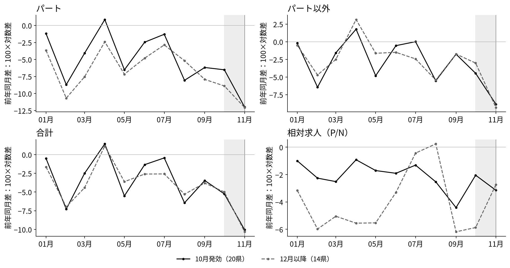

<!-- _class: title -->

# 最低賃金の発効時期と採用の構成

## パート求人だけが減るのか、求人全体が縮むのか

2025年11月の1か月を、10月発効20県と12月以降発効14県で比べる。

2026年11月4日　ミクロ経済学セッション　課題3・4 SHEN MINGWEI・SUN SHAOHAN・WANG JING

---

# 1. 問い：前回の比較に、もう一つの経済問題を足す

前回（課題2）の主比較はそのまま残す。2025年11月に、10月発効20県と12月以降発効14県の<strong>パート新規求人の前年同月比</strong>を比べる。差は「早期−後期」で、改定前（2025年1〜9月）の同じ差を基準にする。

追加する問い：

> 11月に観察される差は、**求人全体の縮小**なのか、**パートとパート以外の構成の違い**なのか。

<ul><li>パートだけが相対的に減るなら、パート比率が下がる。</li><li>全体が同じ率で縮むなら、比率は動かない。</li><li>3系列で規模と構成の動きを記述する。原因の識別とは区別する。</li></ul>

パート以外＝パートタイムを含まない一般求人。正社員だけではない。常用・臨時・季節を含む。

出典：厚生労働省（2026a）第12表－1・－2・－3。用語は厚生労働省「集計結果（用語の解説）」。

---

# 2. データと、使う前の確認

| 系列 | 第12表のシート | 中身 |
|---|---|---|
| 合計 | 第12表－1 | パートを含む一般の新規求人 |
| パート以外 | 第12表－2 | パートを除く一般の新規求人 |
| パート | 第12表－3 | 一般パートタイムの新規求人 |

実際に確かめたこと（analysis.py が実行時に検査）:

<ul><li>2013年1月〜2026年8月、164か月連続。47都道府県、欠損0。全国＝47県の和（各系列で残差0）。</li><li>各月・各県で パート＋パート以外＝合計（最大残差0）。</li><li>最低賃金は年度見出しで列を選び、2025年度の発効日を独立の公式PDF（47県）と照合。20/13/14県に分かれることを確認。</li></ul>

出典：厚生労働省（2026a，2026b）。最低賃金の照合は厚生労働省「令和7年度 地域別最低賃金額一覧」p.3。

---

# 3. 主な結果：差は小さいが、向きは「パートが相対的に弱い」

11月の前年同月比 − 1〜9月平均の前年同月比（県内で計算し、各県を等しく重み付け）

| 指標 | 早期−後期 | 95%区間 | 片側 p（負） |
|---|---:|---:|---:|
| パート | −1.56 | [−7.93, +4.82] | 0.31 |
| パート以外 | +0.67 | [−3.02, +4.37] | 0.65 |
| 合計 | −0.15 | [−4.15, +3.85] | 0.47 |
| 相対（パート−パート以外） | −2.23 | [−8.05, +3.59] | 0.22 |
| パート比率（pp） | −0.51 | [−1.85, +0.82] | 0.22 |

<ul><li>合計の点推定はゼロに近く、相対指標の点推定は負である。</li><li>どの区間も0を含む。負の差を明確には確認できず、規模の縮小も排除できない。</li><li>相対＝パート−パート以外（−1.56−0.67＝−2.23）。比率は同じ原系列の補助指標だが、差分・平均後に相対指標と同値ではない。</li></ul>

注：Welch の記述的な区間。県を独立とみなす近似で、因果推論ではない。n=20, 14。

---

# 4. 推移を見る：10月の山と11月の落ち込み

各月・各群の県単純平均。縦軸は100×対数差（前年同月比の近似）。灰色は2025年10月、縦線は11月。出典：厚生労働省（2026a）。

---

<!-- _class: equations -->
# 5. モデル：CESの相対需要＋規模

新規部門がパート・パート以外の採用を選ぶ。既存従業員は省く。

$$
\max_{H_P,H_N\geq0}\;\left\{\frac{B}{\beta}Z^\beta-c_PH_P-c_NH_N\right\},\qquad 0<\beta<1
$$

単価 $c_j$ は期間賃金＋採用経費。$Z$ はCES合成、$V_j=H_j/q_j$。

$$
\begin{aligned}
\frac{H_P}{H_N} &= \left(\frac{a}{1-a}\right)^\sigma\left(\frac{c_N}{c_P}\right)^\sigma, \\[0.65em]
\frac{\partial\ln H_N}{\partial\ln c_P} &=
\underbrace{\sigma s_P\vphantom{\frac{s_P}{1-\beta}}}_{\text{Substitution}}
-\underbrace{\frac{s_P}{1-\beta}}_{\text{Scale}}.
\end{aligned}
$$

代替と規模縮小の強さにより、パート以外は**増えることも減ることもある**。

σ：代替の弾力性、a：CESの重み、sP：総費用に占めるパートの割合。 q：一定の充足率。数値例は仮定値。パート以外を「無処理の対照」とは呼べない。

CESの骨格：Acemoglu and Autor (2011), pp.1103–1105。採用費用・規模は本稿の簡略化。 Ohta and Komae (2022), 4.3節・Table 5。

---

# 6. モデルから出る予測と、データとの照合

共通の比例費用上昇：合計は下がり、相対は動かない。今回は区間が広く、排除できない。 
パート費用だけ上昇：相対は下がる。符号は一致するが、明確な差は確認できない。 
相対＝パート−パート以外は計算上の恒等式であり、モデルの検証結果ではない。

| | 予測 | 実測（点推定） | 判定 |
|---|---|---|---|
| 合計 | 負（共通費用） | −0.15 | 区間が広い |
| 相対 | 負（パート選別） | −2.23 | 符号のみ一致 |
| パート以外 | 符号は不定 | +0.67 | 機序は判別不能 |

「パート以外がプラスだから代替が起きた」とは言えない。点推定が小さく、区間も広い。モデルは符号の候補を示すだけで、機構を識別しない。

---

# 7. 基準期間の変更と、解釈の限界

<table style="width:100%"><thead><tr><th>指標</th><th>1〜9月基準</th><th>1〜7月基準</th></tr></thead><tbody>
<tr><td>パート</td><td>−1.56 [−7.93, 4.82]</td><td>−2.18 [−8.85, 4.49]</td></tr>
<tr><td>パート以外</td><td>+0.67 [−3.02, 4.37]</td><td>+0.71 [−3.23, 4.65]</td></tr>
<tr><td>合計</td><td>−0.15 [−4.15, 3.85]</td><td>−0.38 [−4.65, 3.88]</td></tr>
<tr><td>相対</td><td>−2.23 [−8.05, 3.59]</td><td>−2.89 [−8.90, 3.12]</td></tr>
</tbody></table>

<ul>
<li>8〜9月は改定額公表後の期間を含むため、1〜7月基準も併記した。点推定はやや大きく、区間も広い。どちらでも合計 ≈ 0、相対は負で0をまたぐ。</li>
<li>因果ではない。発効時期は政策交渉・災害・賃上げ額と一緒に決まる。早期群は水準が高く、引上げ率は低い（6.39% vs 7.78%）。同比は2024年度改定の効果も引く。</li>
<li>求人 ≠ 採用 ≠ 雇用。新規求人は採用予定人員で、充足数でも雇用者数でもない。受理地の統計で、勤務地別ではない。</li>
<li>パート以外は対照群ではない。正社員だけではなく常用・臨時・季節を含む。企業内の代替の証拠でもない。20県対14県では検出力が低く、0を含む区間は「差なし」の証明でもない。</li>
</ul>

注：括弧は Welch の95%区間。各県を等しく重み付けし、全国計は使っていない。

---

# 8. まとめ

<ul>
<li>前回の主比較（パート求人の早期−後期）は維持した。11月の差は −1.56 で、仮説と同じ負だが統計的には言えない。</li>
<li>追加した問いには、合計 ≈ 0、相対 −2.23 という形で答える。構成の方向は仮説と整合するが、これも0を含む。</li>
<li>2類型のCESモデルは、パート以外が増える場合と減る場合の両方を許す。「パート以外＝対照」という読み方はできない。</li>
<li>次に必要なのは県×月を増やすことではなく、求人票レベルでの職種・賃金帯・実際の充足の情報。このデータだけでは、採用選別と規模縮小を分けきれない。</li>
</ul>

---

<!-- _class: refs -->

# 参考文献・データ

Acemoglu, D. and D. Autor (2011) "Skills, Tasks and Technologies: Implications for Employment and Earnings," in O. Ashenfelter and D. Card (eds.), *Handbook of Labor Economics*, Vol. 4B, ch.12, pp.1043–1171. 式(2)〜式(6)、pp.1103〜1105。https://economics.mit.edu/sites/default/files/publications/Skills%2C%20Tasks%20and%20Technologies%20-%20Implications%20for%20.pdf

Ohta, S. and K. Komae (2022) "Vacancies, Job Seekers, and Minimum Wages: Evidence from Public Employment Placement Service Data," Keio-IES Discussion Paper DP2022-004. 4.3節・Table 5（p.21）。https://ies.keio.ac.jp/upload/DPEN_7694_202203091453351.pdf

Kanayama, H., S. Miyaji and S. Otani (2026) "Just After Minimum Wage Hikes: Short-Run Labor-Demand Response and Reallocation," arXiv:2505.04555v3. https://arxiv.org/pdf/2505.04555v3

Kazekami, S. and M. Abe (2025) "Effects of minimum wage changes on labor demand: analysis using job postings data," *Applied Economics*, online 14 Nov 2025. https://doi.org/10.1080/00036846.2025.2579945

厚生労働省（2026a）「一般職業紹介状況（職業安定業務統計）長期時系列表 第12表 都道府県（受理地）別 雇用形態別 新規求人数」https://www.e-stat.go.jp/stat-search/file-download?statInfId=000040505323&fileKind=0

厚生労働省（2026b）「地域別最低賃金改定状況」https://www.mhlw.go.jp/content/11200000/001756130.xlsx ／「令和7年度 地域別最低賃金額一覧」https://www.mhlw.go.jp/content/11201250/001729623.pdf

厚生労働省「集計結果（用語の解説）」https://www.mhlw.go.jp/toukei/list/114-1_yougo.html （パートタイム・正社員・新規求人の定義）
