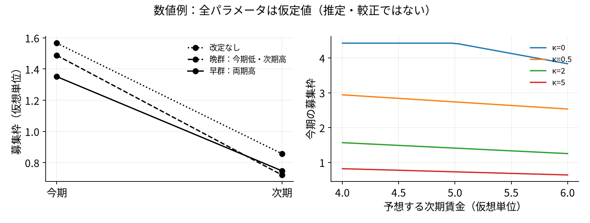
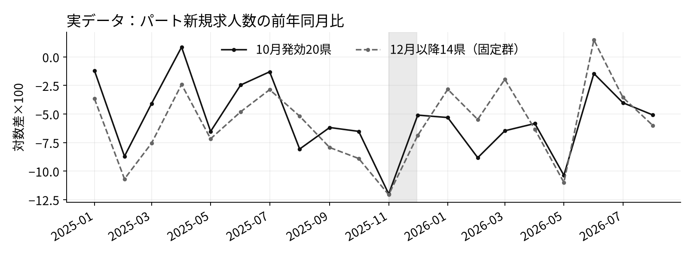
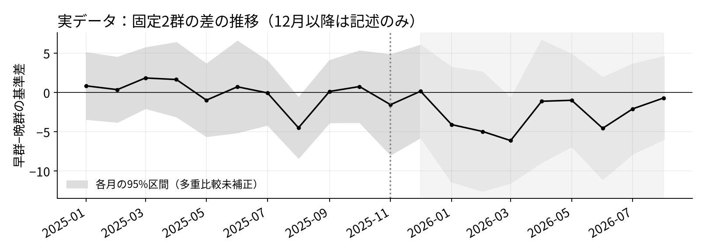

<!-- _class: title -->
# 最低賃金の発効時期とパート求人
## 将来賃金と採用の前後配分

企業は、今採るか、将来の賃金と募集費用を負担して後で採るか。

2026年11月4日　ミクロ経済学セッション
課題3：モデル・仮説 ／ 課題4：検証までの試行

SHEN MINGWEI・SUN SHAOHAN・WANG JING 主比較は既発表どおり、2025年11月の早20県対晩14県。

---
# 先取りや動学自体を「新発見」とはしない

| 近い先行研究 | 調べたこと | 今回との違い |
|---|---|---|
| 太田・小前 (2022), Table 5 [6] | ハローワークのpart求人と最低賃金。全期間は負、後期は弱い | 金額の変化を分析 |
| 風神・阿部 (2025), §§II–III [7] | 商業求人広告の賃金帯分布。純増も報告 | 求人数の符号は一方向でない |
| Kudlyakほか, IZA 2023版 [5] | 米国求人の先取りと改定後の動学 | 職業曝露を使うDDD |
| Nowcast・連合 (2026), §§3–4 [12] | 2025年度の早遅群の募集賃金・東京の求人退出 | 発効時期の研究とも重なる |

今回の追加は、**今期だけでなく次期にも採用を選べる企業**で、
将来賃金と募集費用が採用の時期をどう変えるかを整理すること。

実証は単純な差分のまま。先送りが雇用を守ったという因果結論は目指さない。

---
<!-- _class: equations -->
# 企業は二期の募集枠を選ぶ

Hamermesh (1993), III.A, 本文pp.4–5を土台にした授業用の簡略化。[3]
原論文はgross／net調整費用を区別する。本案はgross側に絞る。

$$
L_1=rL_0+qv_1,\qquad L_2=rL_1+qv_2
$$

$$
\begin{aligned}
\max_{v_1,v_2\geq0}\quad &R(L_1)-w_1L_1-C(v_1) \\[0.4em]
&{}+\beta\bigl[R(L_2)-\bar w_2L_2-C(v_2)\bigr]
\end{aligned}
$$

$$
R(L)=aL-\frac{b}{2}L^2,\qquad C(v)=cv+\frac{\kappa}{2}v^2
$$

v：募集枠、q：充足率、r：残存率、κ：募集を増やす限界費用の曲率。 固定工時・外生賃金、qとrは一定、裁員なし、予想経路は既知、期末価値ゼロを仮定。 法定時給ではなく一人当たり期間賃金wを考える。DMP・構造推定ではない。

---
<!-- _class: equations -->
# 将来も採れるため、当期採用と次期採用が代替する

当期採用の一階条件（両期とも正の募集の内点）：

$$
\begin{aligned}
&q\bigl[R'(L_1)-w_1\bigr]+\beta rq\bigl[R'(L_2)-\bar w_2\bigr] \\[0.5em]
&\qquad = c+\kappa v_1
\end{aligned}
$$

| 変化（他の条件一定） | 今期 $v_1$ | 次期 $v_2$ |
|---|:---:|:---:|
| 現在の賃金 $w_1$ が上がる | 減る | 相対的に増える |
| 予想する次期賃金 $\bar w_2$ が上がる | $r,\kappa>0$ なら減る | 減る |

- 両群の次期賃金等が同じなら、早群は今期少なく、次期は晩群より多く採る。
- これは**同じ次期での相対的な補い**。$v_2>v_1$ や雇用の回復とは限らない。

κ=0またはr=0なら、このモデルの内点でv₁の将来賃金への反応はゼロ。 晩群の将来賃上げが大きい場合やゼロ募集の角点では、単純な符号予測を適用できない。解・導関数はmethods.md。

---
# 仮定値で確かめる：先取りと相対的な補い

仮定値：(a,b,q,r,β,κ,c,L₀)=(10,1,.8,.8,.95,2,.2,3)。円・県の推定ではない。 賃金経路は改定なし(4,4)、晩群(4,4.5)、早群(4.5,4.5)。 v₁：1.566 → 晩1.488／早1.351、v₂：晩0.721／早0.747。次期も最適に選ぶ。

右図のκ=0の折れ点以降はv₂=0の角点。内点の導関数は使わない。 独自計算。200組でKKT・独立数値最適化を検査、134内点で導関数を照合。数学的検査であり、実証的な較正ではない。二期の終端を長期均衡とみなさない。

---
# 11月は法的な適用差が明瞭。ただし予想は残る

早群20県は11月には全月適用。晩群14県の状態は次のとおり。[2]

| 暦月 | 全月適用 | 部分適用 | 全月未発効 |
|---|---:|---:|---:|
| 2025年11月 | 0 | 0 | 14 |
| 12月 | 7 | 1 | 6 |
| 2026年1〜2月 | 12 | 0 | 2 |
| 3月 | 13 | 1 | 0 |
| 4月以降 | 14 | 0 | 0 |

8月4日に目安公表、9月5日に全県答申を集約。法定未発効≠予想反応なし。[8][9] 11月から1／2／4か月先まで未発効の晩群は6／2／0県だけ（日付上の必要条件）。 1〜7月基準も完全な「予期なし」ではない。12月以降は元の晩群を未処置対照としない。

---
<!-- _class: equations -->
# 主検定は、既発表の県等重みの差分

$$
\begin{aligned}
y_{it} &= 100\bigl(\log V_{it}-\log V_{i,t-12}\bigr), \\[0.45em]
d_i &= y_{i,\mathrm{Nov}}-\bar y_{i,B}, \\[0.45em]
\widehat\tau &= \bar d_{\mathrm{E}}-\bar d_{\mathrm{L}}.
\end{aligned}
$$

B：2025年1〜9月、Nov：2025年11月、E：早20県、L：晩14県。

- $H_1:\tau<0$。OLSの $d_i=\alpha+\tau\,\mathrm{Early}_i+u_i$ と同じ点推定。
- Welchの95%区間、負方向の片側pと両側pを併記。政策単位は34県。
- 1〜7月基準も計算。引上げ率調整は補助OLSだけ。

Vはハローワーク新受理の採用予定人数（受理地）であり、採用実績・雇用ではない。[1] 同比は前年政策も差し引く。2024年度も改定があり、徳島は11月1日発効。[2][11] 発効日と引上げ率・企業準備・災害等は関連しうる。調整しても因果識別にはならない。[10] 独立県を仮定した近似区間で、無作為割付の検定でもモデルのκの推定でもない。

---
# 11月の差は−1.56。明確な負の差とは言えない

| 基準期 | 基準期からの早晩差の変化 | Welch 95%区間 | 片側p／両側p |
|---|---:|---:|---:|
| 1〜9月（主） | −1.56 | [−7.93, 4.82] | .310 ／ .620 |
| 1〜7月（感度） | −2.18 | [−8.85, 4.49] | .253 ／ .506 |

単位：対数差×100。主基準からの変化は早群−7.81、晩群−6.25。 符号はH1と同じだが不確実性が大きい。「効果なし」とも断定しない。出典：[1][2]より計算。

---
# その後の差にも、相対的な補いは明瞭でない

4〜6月の早晩差−11月の早晩差＝−0.67、95%区間[−6.16, 4.82]。 探索的な形の確認。点推定は相対的な補いと逆方向だが、精度が低い。出典：[1][2]より計算。

- 予想賃金と募集費用を入れると、「発効前なら未調整」とは限らない。
- 両群の将来賃上げ幅・需要・離職等は同じでなく、月を二期に直結できない。
- **後続の線は記述だけ**。費用・期待・catch-upを識別したとは言わない。

結論：当期と将来の採用の配分という問いは追加できたが、既存データが検査できるのは時序と群間差まで。制度の先送りを推奨する根拠にはならない。

---
<!-- _class: refs -->

補足：Hamermesh 1990版[4]は静的期待を置く別モデル。詳細な版・頁・検査記録はsources.md。

## Sources

[1] https://www.e-stat.go.jp/stat-search/file-download?statInfId=000040505323&fileKind=0 — 一般職業紹介状況 第12表
[2] https://www.mhlw.go.jp/content/11200000/001756130.xlsx — 地域別最低賃金改定状況
[3] https://www.nber.org/system/files/working_papers/w4394/w4394.pdf — Hamermesh 1993 NBER WP4394
[4] https://www.nber.org/system/files/working_papers/w3356/w3356.pdf — Hamermesh 1990 NBER WP3356
[5] https://docs.iza.org/dp15254.pdf — Kudlyak Tasci Tuzemen IZA DP15254 Jan2023
[6] https://ies.keio.ac.jp/upload/DPEN_7694_202203091453351.pdf — Ohta Komae 2022 DP2022-004
[7] https://www.tandfonline.com/doi/full/10.1080/00036846.2025.2579945 — Kazekami Abe 2025 published
[8] https://www.mhlw.go.jp/stf/newpage_60788.html — 2025-08-04目安公表
[9] https://www.mhlw.go.jp/stf/newpage_63030.html — 2025-09-05答申まとめ（予定）
[10] https://www.mhlw.go.jp/content/11201250/001714252.pdf — 2026-06-23発効時期の検討
[11] https://www.mhlw.go.jp/content/11302000/001531874.pdf — 2024年度確定一覧
[12] https://nowcast.co.jp/news/20260707 — Nowcast 2026-07-07 最低賃金・募集賃金・求人量
