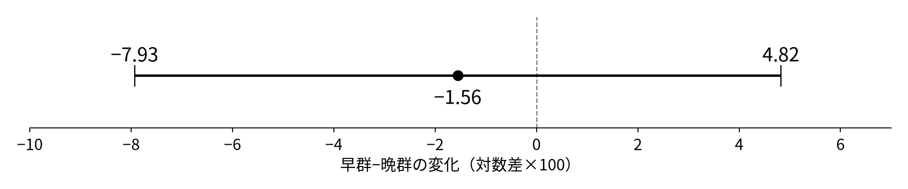
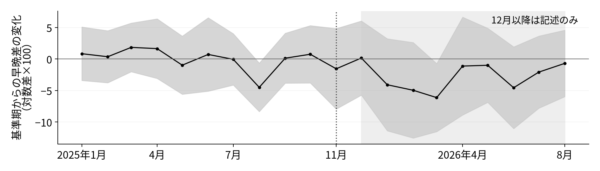

<!-- _class: title -->
# 最低賃金の発効時期とパート求人
## ある店は、今採るか、後で採るか

パートを募集する店を考える。今採った人の一部は、次期にも働く。

- 今採ると、今期の売上に貢献するが、次期の賃金もかかる。
- 後で採ると、今期の売上を逃し、次期に募集を集中させる。
- 発効が遅い県でも、将来の賃上げを知れば今の募集を変えうる。

> 2026年11月4日　ミクロ経済学セッション／課題3・4 SHEN MINGWEI・SUN SHAOHAN・WANG JING 企業の考え方を二期モデルで整理し、既発表の2025年11月比較を確かめる。

<!-- 今日は、店長が今募集するか、後で募集するかを考えるところから始めます。今期だけの人件費では決められません。採った人が次期にも残るからです。ただし、この話が実際の県別求人の動きを説明したと最初から決めるわけではありません。モデルの条件を示した後で、実際の数字が何を言えるかを分けて見ます。 -->

---
# 先行研究に、採用する時期の説明を加える

| 研究・使用した版 | 何を比べ、何が分かったか |
|---|---|
| 太田・小前 (2022), Table 5 [6] | 日本のハローワークのパート求人と最低賃金の変化。全期間は負、後期の結果は弱い。 |
| 風神・阿部 (2025), 公刊版 [7] | 商業求人広告の賃金帯を改定前後で比較。広告の純増も報告。 |
| Kudlyakほか (2023改訂版) [5] | 米国の職業別の影響されやすさを使う比較。発効前の反応と、その後の動きも分析。 |
| Nowcast・連合 (2026) [12] | 2025年度の早遅群の募集賃金、東京の求人退出を分析。今回に近い時期の問い。 |

> 今回多く問うのは、次期にも採用できる企業が「今と後の募集」をどう配分するか。 先取り自体を新発見とはしない。同じ11月比較を説明する授業用の拡張であり、 モデルが詳しくなっても、実証の因果的な証拠が強くなるわけではない。

<!-- 太田・小前は近い求人統計を使っていますが、金額の変化を分析しており、私たちと同じ早晩比較ではありません。風神・阿部は逆方向の結果も示します。さらに、先取りや求人の動学はすでに研究されています。今回の追加は、新しい識別手法ではなく、同じデータを見るときに、今採用した人の将来費用と後から採用する費用を明示することです。 -->

---
# 数えるのは、ハローワークの新しい募集人数

| 項目 | 今回使うもの |
|---|---|
| 求人 | 第12表「一般パート」の新規求人数、受理地別 [1] |
| 意味 | その月に新しく受理した求人の採用予定人員 |
| 期間 | 2023年1月〜2026年8月、47県×44か月 |
| 政策 | 2025年度の最低賃金額・発効日。2024年度も確認 [2][11] |
| 主比較 | 2025年11月、10月発効20県（E）対12月以降14県（L） |

- 広告の枚数、実際の採用人数、在籍従業員数とは違う。
- 民間媒体は含まない。受理地は、実際に働く場所と一致しない場合がある。
- 各県を同じ重みで比べる。全国の求人総数への効果を測る計算ではない。

同じ表・雇用形態・暦月で比較。元表の月の連続性、47県、全国計、内訳の整合性を確認。 以下、Eは早群、Lは晩群を表す。式の中にもこのラテン文字を用いる。

<!-- 新規求人の「新規」は、その月に新たに受理したという意味です。店が募集した全員を採用できたとは限りませんし、民間サイトだけで募集した分は入りません。県名も受理した場所に付いています。したがって、モデルの募集枠に近い指標ではありますが、企業の募集を完全に観察するわけではありません。県等重みなので、東京も小さな県も一県として扱います。 -->

---
# 11月は適用状態をそろえやすいが、同じ県ではない

| 2025年度の分け方 [2] | 11月の法的な適用 | 県数 |
|---|---|---:|
| 10月発効（早群） | 全月、新しい最低賃金を適用 | 20 |
| 12月以降発効（晩群） | 全月、まだ発効していない | 14 |
| 11月発効 | 既発表のルールで主比較から除外 | 13 |

- 同じ11月なので、全国共通の季節や景気の変動をある程度そろえられる。
- ただし引上げ率は早群6.39%、晩群7.78%。賃金水準や都市構成も違う。
- 日程も無作為ではない。企業の準備や災害等と関係しうる。[10]
- 8月4日に目安公表、9月5日に全県答申が集約された。 **法的に未発効でも、企業が知らないとはいえない。** [8][9]

引上げ率は県別率の単純平均。[2]より計算。11月1日発効の県があることは否定しない。 「早群で発効しなかった場合の動き」を晩群が再現するかは、これだけでは確認できない。

<!-- 11月を選ぶのは、早群は全月改定後、晩群は全月改定前と整理できるからです。11月群を全部「月途中の適用」と説明するのは正しくありません。元のルールで除外します。一方、晩群は引上げ率が大きく、県の特徴も異なります。さらに、店は発効前から賃上げを予想できます。この二つが、モデルの単純な条件と実際の比較の距離になります。 -->

---
<!-- _class: equations -->
# 今期の従業員は、残る人と新しく採る人

$$
L_1=rL_0+qv_1
$$

| 記号 | 店の行動・人数との対応 |
|---|---|
| $L_0,\ L_1$ | 最初の従業員数、今期に働く従業員数（人） |
| $rL_0$ | 最初の従業員のうち今期まで残る人数。$r$ は残存率。 |
| $v_1$ | 店が今期に募集する人数（募集枠）。店が選ぶ変数。 |
| $qv_1$ | 実際に採れる人数。$q$ は募集枠が充足する割合。 |

募集を増やしても、全員が採れるとは限らない。だから $v_1$ と $L_1$ を分ける。

> 同質の労働・固定工時を仮定。$0<q\leq1,\ 0\leq r\leq1$。 以下、$q,r$ は賃金によらず一定。店は解雇せず、離職分を補うかどうかを選ぶ。

<!-- 最初に、働いている人数と募集する人数を分けます。最初の従業員が全員残るとは限らず、募集枠も全て埋まるとは限りません。残存率と充足率を一定としておけば、店が募集人数を選ぶと従業員数が決まります。これは計算のための仮定で、賃上げで離職が減るような効果は、まだ入っていません。 -->

---
<!-- _class: equations -->
# 今採った人の一部は、次期にも残る

$$
\begin{aligned}
L_2&=rL_1+qv_2\\[0.4em]
&=r^2L_0+rqv_1+qv_2
\end{aligned}
$$

- $L_2$：次期に働く従業員数。$v_2$：次期の募集枠で、これも店が選ぶ。
- 今期に募集を1枠増やすと、今期の人数は $q$ 人、次期は $rq$ 人増える。
- 次期にも募集できるので、今多く採ると、後で必要な募集は減りうる。
- ただし今期の未充足枠は、次期の求人として自動的には繰り越さない。

> 「今期・次期」は二つの調整局面。11月と翌4月に厳密に対応させない。 二期末の価値はゼロと置くため、最終期の数字を長期均衡とは読まない。

<!-- 次期には、今期の従業員のうち残った人に、次期の新しい採用が加わります。式を展開すると、今期の募集が次期にも人数を増やすことが見えます。そのため、今期と次期の募集は無関係ではありません。ただし最後の期より後の利益を無視する簡略化なので、次期の募集が少なくなる数値例を、そのまま現実の季節変動とは解釈できません。 -->

---
<!-- _class: equations -->
# 人を増やすと売上も募集の負担も増える

$$
R(L)=aL-\frac b2L^2,\qquad R'(L)=a-bL
$$

$R$ は人件費・募集費を払う前の収入。$a>0,\ b>0$。 人数を増やすほど、もう一人による収入の増加は小さくなる。

$$
C(v)=cv+\frac\kappa2v^2,\qquad C'(v)=c+\kappa v
$$

$C$ は募集・採用準備等の費用。$c\geq0,\ \kappa\geq0$。 募集を一度に増やすと、人事・研修等の限界負担が増える場合を表す。

> $R,C$ は各期の金額、$R'$ は一人当たり、$C'$ は一募集枠当たりの金額。 $b,\kappa$ はそれぞれ人数・募集枠を増やしたときの傾き。二次式は授業用の仮定で、 実測した売上関数や広告料金表ではない。

<!-- 採用を無限に増やさない理由は、追加の収入が小さくなる一方で、追加の募集負担が増えるからです。カッパは募集一枠の固定料金ではなく、募集を増やすほど負担が増える度合いです。ゼロなら募集費は線形になります。こうした滑らかな二次式は解きやすくするための選択であり、実際の費用を推定したものではありません。 -->

---
<!-- _class: equations -->
# 店は、二期の利益の合計を最大にする

$$
\begin{aligned}
\max_{v_1,v_2\geq0}\quad
& R(L_1)-w_1L_1-C(v_1)\\[0.5em]
&+\beta\bigl[R(L_2)-\bar w_2L_2-C(v_2)\bigr]
\end{aligned}
$$

- $w_1,\bar w_2$ は今期・予想する次期の一人当たり期間賃金。 法定時給そのものではなく、固定した工時分の賃金総額。
- $0<\beta\leq1$ は次期の利益を今の価値に換算する割引係数。
- 外生賃金、既知の予想経路、その後の新情報なし。最低賃金が実際の賃金を上げる場合を考える。

> Hamermesh (1993), III.A pp.4–5の将来利益・採用調整費用を土台にした独自の二期簡略化。[3] 原論文の方程式ではない。純雇用変化の費用を省き、一定 $q,r$ 等を追加した。 資金制約はないので「賃金を節約して採用資金を作る」という経路は導いていない。

<!-- 一期ごとの利益は、収入から従業員全員の賃金と募集費を引いたものです。次期の利益を割り引いて足します。ここでの賃金は時給ではありません。Hamermeshから借りるのは、将来利益と採用調整費用を考える枠組みで、この二期の式そのものを原論文の式と呼びません。店が賃金を選ぶモデルでも、資金不足を扱うモデルでもありません。 -->

---
<!-- _class: equations -->
# 次期は、追加採用の便益と費用を比べる

今期の従業員 $L_1$ が決まった後、次期の募集を1枠増やす。

$$
q\bigl[a-bL_2-\bar w_2\bigr]=c+\kappa v_2
$$

左辺：$q$ 人を採ることによる追加収入から、追加の賃金を引いた額。 右辺：募集を1枠増やすための追加費用。

$L_2=rL_1+qv_2$ を代入して、$v_2$ をまとめると、

$$
v_2=\frac{q(a-brL_1-\bar w_2)-c}{bq^2+\kappa}
$$

> この式は正の募集が最適な場合。今期から残る人 $rL_1$ が多いほど、追加募集は少ない。 右辺が非正なら、次期は募集ゼロを選ぶ。二期末より後の採用便益は入らない。

<!-- 最後の期から考えると分かりやすくなります。次期に一枠募集すると、採れる人数だけ追加の収入と賃金が発生します。その純便益が募集の限界費用と等しくなる点を選びます。割引係数は両辺から消えます。従業員の式を代入すれば、今期から多くの人が残っている店ほど次期の募集が少なくなることが、分子からも確認できます。 -->

---
<!-- _class: equations -->
# 今期の採用は、次期の利益も変える

両期で正の募集をする場合の、今期の一階条件：

$$
\begin{aligned}
&q\bigl[a-bL_1-w_1\bigr]\\[0.35em]
&\quad+\beta rq\bigl[a-bL_2-\bar w_2\bigr]
=c+\kappa v_1
\end{aligned}
$$

- 第1行：今期に採れる $q$ 人がもたらす、今期の純便益。
- 第2行：次期まで残る $rq$ 人の純便益を、$\beta$ で割り引いた額。
- 右辺：今期に募集を1枠増やす費用。

> 次期の条件も満たすと、次期の純便益 $q[a-bL_2-\bar w_2]$ は $c+\kappa v_2$。 したがって、今採るかどうかは、次期に改めて募集する負担ともつながっている。

<!-- 今期に採った人は、今期だけでなく次期にも一部残ります。だから今期の便益だけで募集を決めるのではありません。次期の募集も最適に選び直せるので、次期の募集がどう変わるかまで考えます。ただし最適点では次期の募集についての微小な変更の効果がゼロなので、今期の一階条件に次期の募集の微分を別に足す必要はありません。 -->

---
<!-- _class: equations -->
# 今期の賃金が高いと、今減らし、後で一部補う

二つの一階条件は、募集 $v_1,v_2$ の連立一次方程式になる。

$$
H=\begin{pmatrix}
bq^2(1+\beta r^2)+\kappa&\beta brq^2\\
\beta brq^2&\beta(bq^2+\kappa)
\end{pmatrix},\qquad D=\det H>0
$$

$H_{12},H_{22}$ は行列 $H$ の1行2列・2行2列。$D$ はその行列式。 目的は厳密に凹なので、制約を満たす一階条件の解が一意の最適解。

$$
\frac{\partial v_1}{\partial w_1}=-\frac{qH_{22}}D<0,\qquad
\frac{\partial v_2}{\partial w_1}=\frac{qH_{12}}D\geq0
$$

> 他の条件、特に次期賃金が同じなら、今期賃金が高い早群は今期の募集が少ない。 その分、次期の募集は晩群より多い（$r>0$）。これは同じ次期で比べた「相対的な補い」。 $v_2>v_1$ や、従業員数が元に戻ることを意味しない。両期正の募集の内点に限る。

<!-- 人数の式を一階条件に入れると、未知数は二つの募集枠だけになります。その係数をまとめたものが行列Hです。行列式が正で解が一意となり、賃金を少し上げたときの傾きが下の二つです。今期賃金だけが高ければ今期に採る人数を減らすため、次期に残る人も減り、次期の新しい募集は相対的に増えます。これは時系列で求人が必ず回復するという意味ではありません。 -->

---
<!-- _class: equations -->
# 将来賃金も、条件によって今の募集を減らす

今期賃金を変えず、予想する次期賃金 $\bar w_2$ だけを上げると、

$$
\frac{\partial v_1}{\partial\bar w_2}
=-\frac{\beta^2rq\kappa}{D}\leq0,\qquad
\frac{\partial v_2}{\partial\bar w_2}
=-\frac{\beta q(bq^2+\kappa)}{D}<0
$$

- $r>0,\ \kappa>0$：今採った人にも将来賃金がかかる。後で採るにも負担が増すため、両期の募集を調整する。
- $r=0$：今採った人が次期に残らず、この今期への経路は消える。
- $\kappa=0$：次期募集を動かしやすく、内点では今期の反応はゼロ。
- どちらかが募集ゼロの境界では、この微分式をそのまま使えない。

> 同じ係数・両期内点で、早群−晩群の賃金差を $\Delta w_1,\Delta\bar w_2$ とすると、

$$
\Delta v_1=-\frac{qH_{22}\Delta w_1+\beta^2rq\kappa\Delta\bar w_2}{D}
$$

> 晩群の将来賃上げが大きいなど、次期の条件も違えば、早晩差の符号は保証できない。

<!-- 将来賃金の上昇は今採った人の将来費用を増やしますが、次期の採用を自由に減らして相殺できるとは限りません。募集費用に曲率があることと、今採った人が次期に残ることが、このモデルの今期の反応には必要です。最後の式は二群で次期賃金も異なる場合です。同じ係数と内点の範囲で比較しており、実際の晩群は引上げ率も違うので、早群の募集が必ず少ないとは言いません。 -->

---
# 仮定値なら、先取りと相対的な補いが見える

| 賃金の想定 $(w_1,\bar w_2)$ | 今期の募集 $v_1$ | 次期の募集 $v_2$ |
|---|---:|---:|
| 改定なし $(4,4)$ | 1.566 | 0.857 |
| 晩群：次期だけ高い $(4,4.5)$ | 1.488 | 0.721 |
| 早群：両期高い $(4.5,4.5)$ | 1.351 | 0.747 |

- 改定なし→晩群：まだ今期賃金が同じでも、今期募集は減る。
- 晩群→早群：今期募集は少ない一方、次期募集は少し多い。
- それでも次期従業員数は、早群3.382人、晩群3.449人。 **次期の募集が多いことと、雇用が回復することは別。**

> 全て仮定値・推定ではない。$(a,b,q,r,\beta,\kappa,c,L_0)=(10,1,.8,.8,.95,2,.2,3)$。 賃金・金額は仮想単位で、円や県の実測値ではない。既存モデルの最適解を計算。 式の計算が正しいことを確かめる例であり、現実の店がこう動いた証拠ではない。

<!-- 既存コードで同じ企業に三つの賃金経路を与え、両期の募集を解いた結果です。まず改定なしと晩群を比べると、今期の賃金が同じでも募集が減っています。次に晩群と早群を比べると、早群は今期少なく、次期に少し多く募集します。それでも従業員数は早群のほうが少ないままです。小数の人数は連続量のモデルなので、実際に端数の人を採用したという意味ではありません。 -->

---
<!-- _class: equations -->
# 条件付きの予測を、県別求人で確かめる

モデル：次期賃金・需要・$q,r$ 等が同じなら、早群の今期募集は少ない。

データ：各県の前年同月比が、基準期から11月にどれだけ変わったかを比べる。

$$
\begin{aligned}
y_{it}&=100\bigl(\log V_{it}-\log V_{i,t-12}\bigr),\\[0.4em]
d_i&=y_{i,\mathrm{Nov}}-\bar y_{i,B},\qquad
\widehat\tau=\bar d_{\mathrm E}-\bar d_{\mathrm L}
\end{aligned}
$$

> $V_{it}$：県 $i$・月 $t$ の新受理の採用予定人員。$y$：前年同月比の対数近似。 $B$：2025年1〜9月。Nov：2025年11月。上線は月平均または県平均を表す。

- 既発表の方向仮説は $H_1:\tau<0$。検定の帰無仮説は $H_0:\tau\geq0$。
- 企業の募集水準と、県集計の前年同月比は同じ量ではない。 需要・離職・充足率・求人媒体や企業構成が違えば、対応は崩れる。

<!-- 式の予測を直接検査するには企業ごとの賃金や充足率が必要ですが、このデータにはありません。そこで、元の発表の方向仮説を変えずに、県内の前年同月比の変化を早晩で比べます。これはモデルの条件付きの含意との整合性を調べる計算であり、カッパや残存率を推定する検査ではありません。負方向の片側検定は、差がゼロの境界で計算します。 -->

---
# −1.56は、県内の変化を早晩で引いた差

県ごとに $d_i$ を計算してから、各群で県を等しく平均する。[1][2]

| 実データの群平均 | 基準期1〜9月の $y$ | 11月の $y$ | 県内変化 $d$ |
|---|---:|---:|---:|
| 早群20県 | −4.18 | −11.99 | −7.81 |
| 晩群14県 | −5.80 | −12.06 | −6.25 |
| 早群−晩群 | +1.62 | +0.07 | **−1.56** |

$$
\widehat\tau=(-7.81)-(-6.25)\simeq-1.56
$$

- 11月だけなら両群の前年同月比はほぼ同じ。
- ただし基準期は早群のほうが高かったため、早群の低下幅が大きい。
- 求人数が1.56人減った、全国で1.56%減った、という意味ではない。

単位は対数差×100の差。表示は丸め値、計算は丸め前。dは求人水準ではなく前年同月比の変化。 元の基準差があることは差分を取る理由であり、負方向の結果が必然だった理由ではない。

<!-- 表は左から右に読みます。まず各県の前年同月比を作り、基準期の平均を引きます。それから県内変化を群で平均すると早群はマイナス7.81、晩群はマイナス6.25です。二つを引くとマイナス1.56になります。基準期に早群が上だったことだけでは、差が縮まると予言できません。実際に11月までにどちらがどれだけ動いたかが必要です。 -->

---
# 符号は仮説と同じだが、差の大きさは絞れない

- 横軸：基準期からの早晩差の変化。点は推定値、横線はWelch 95%区間。
- 推定値 −1.56、区間 [−7.93, 4.82]。負方向の片側 $p=.310$、両側 $p=.620$。
- 0だけでなく、かなり大きい負の差と正の差も区間に含む。 **「負の差の証拠が足りない」であって、「影響がない」ではない。**

> 34県を独立とみなす近似的な区間。無作為割付に基づく政策効果の区間ではない。 区間は、同じ手順を繰り返した場合の被覆率が95%となる方法による。 全国的な求人・雇用の規模縮小を、この早晩差だけで否定することもできない。

<!-- 点がゼロの左にあるので方向は仮説と一致しますが、横線が左右に長く広がっています。片側pが0.310なので、通常の水準では負方向の差を明確に示せません。これはゼロが正しい確率を意味しませんし、効果がない証明でもありません。加えて、日程の内生性や先取りの問題は、標本誤差の区間とは別に残っています。 -->

---
# 基準期を短くしても、不確実性は残る

| 同じ11月・同じ34県での比較 | 早晩差の変化 | Welch 95%区間 | 片側 $p$ |
|---|---:|---:|---:|
| 1〜9月を基準（主比較） | −1.56 | [−7.93, 4.82] | .310 |
| 1〜7月を基準（感度分析） | −2.18 | [−8.85, 4.49] | .253 |

- 1〜7月は、8〜9月の公表後を基準から外すための確認。 7月には審議が始まっており、予想反応ゼロを保証しない。[8]
- 引上げ率を加えた補助OLSも、点推定−1.36、95%区間[−13.70, 10.98]。 調整変数を一つ足しても、時期だけが異なる県にはならない。
- 前年同月比は繰り返す季節性をある程度抑えるが、前年の政策も差し引く。 2024年度にも改定があり、「政策なしの年」としては使えない。[11]

補助OLSはHC3区間で、主比較のWelch区間とは異なる。出典：[1][2]より既存計算。 都合のよい月・群・基準を選び直さず、先に決めた11月の比較を主に保つ。

<!-- 基準期を変える目的は、結果を有意にすることではなく、公表後の月が基準に入ることへの感度を見ることです。どちらでも負の点推定ですが、区間は広いままです。引上げ率を加えた回帰も補助的な関連でしかありません。また、前年同月比の分母になる年にも最低賃金改定があるため、季節性だけを取り去った純粋な政策効果にはなりません。 -->

---
# その後の線は、採用の「取り戻し」を証明しない

> 横軸は暦月、縦軸は「各月の早晩差−1〜9月の早晩差」。点を結ぶ線は固定34県の差、 帯は各月の95%区間（多重比較未補正）。点線は主比較の11月。0は基準期と同じ差を表す。

- 4〜6月の早晩差−11月の早晩差＝−0.67、95%区間[−6.16, 4.82]。 相対的な補いを明瞭には示さないが、逆方向だと断定する精度もない。
- 晩群の全月未発効は、12月6県、1〜2月2県、3月0県、4月には全県適用。 灰色の12月以降は記述だけ。期待・費用・補充の機構を識別しない。

出典：[1][2]。二期モデルの募集水準を、この県別の前年同月比の線に直接重ねない。

<!-- 図の縦軸は求人の人数でも前年同月比そのものでもなく、早晩差が基準期からどれだけ変わったかです。ゼロより下なら基準期より早群が相対的に低いことを示します。後続の灰色部分では晩群も次々に発効しており、晩群という名前は未処置を意味しません。四月から六月の形の確認でも、取り戻しははっきりしませんが、これを動学モデルの棄却と呼ぶことはできません。 -->

---
# 分かったのは、採用時期の考え方と比較の限界

| 今回できたこと | 今回は分からないこと |
|---|---|
| 今採る人の将来費用と、後で採る費用を分けた | 実際の企業の期待、募集費用、残存率・充足率 |
| 条件次第では発効前にも募集が動くと導いた | 晩群が実際にその理由で先取りしたか |
| 11月の早晩差は−1.56、ただし区間が広い | 発効の先送りが求人や雇用を守ったか |
| その後の群間差を記述した | 長期の回復・雇用・所得や政策の厚生効果 |

- 企業の決定を考える際は、発効日の今期費用だけでなく将来費用も見る。
- 実証では、求人の変化を雇用の変化に言い換えず、 精度不足を「無影響」とも「モデルの正しさ」とも言わない。
- 次に機構を確かめるなら、実際の賃上げ日・採用実績・離職や充足の情報が必要。 この結果だけで、発効の先送りを勧めることはできない。

<!-- 結論は、企業が今と後を同時に考えると、法的な発効前でも募集が動きうるという条件付きの説明です。実際の11月の比較は負方向ですが、差の大きさを十分に絞れていません。モデルの数学が正しいことと、このモデルが現実の理由を特定したことは別です。期待や採用・離職の情報がなければ、先送りの政策評価まで進むことはできません。 -->

---
<!-- _class: refs -->
## Sources

[1] https://www.e-stat.go.jp/stat-search/file-download?statInfId=000040505323&fileKind=0 — 厚生労働省・e-Stat (2026),『一般職業紹介状況』長期時系列・第12表、XLSX版。

[2] https://www.mhlw.go.jp/content/11200000/001756130.xlsx — 厚生労働省 (2026),『地域別最低賃金改定状況』XLSX版、2023〜25年度欄。

[3] https://www.nber.org/system/files/working_papers/w4394/w4394.pdf — Hamermesh, D.S. (1993), “Labor Demand and the Source of Adjustment Costs,” NBER WP4394, July版、III.A pp.4–5。

[5] https://docs.iza.org/dp15254.pdf — Kudlyak, M., M. Tasci and D. Tüzemen, “Minimum Wage Increases and Vacancies,” IZA DP15254, January 2023改訂版（分析引用）。公刊はLabour Economics 97 (2025)。

[6] https://ies.keio.ac.jp/upload/DPEN_7694_202203091453351.pdf — Ohta, S. and K. Komae (2022), “Vacancies, Job Seekers, and Minimum Wages: Evidence from Public Employment Placement Service Data,” Keio-IES DP2022-004。

[7] https://www.tandfonline.com/doi/full/10.1080/00036846.2025.2579945 — Kazekami, S. and M. Abe (2025), “Effects of minimum wage changes on labor demand: analysis using job postings data,” Applied Economics, 公刊版。

[8] https://www.mhlw.go.jp/stf/newpage_60788.html — 厚生労働省 (2025-08-04),『令和7年度地域別最低賃金額改定の目安について』。

[9] https://www.mhlw.go.jp/stf/newpage_63030.html — 厚生労働省 (2025-09-05),『全ての都道府県で地域別最低賃金の答申がなされました』（予定の集約）。

[10] https://www.mhlw.go.jp/content/11201250/001714252.pdf — 中央最低賃金審議会 (2026-06-23),『令和7年度地方最低賃金審議会の審議結果を踏まえた論点と考え方の整理』、§3。

[11] https://www.mhlw.go.jp/content/11302000/001531874.pdf — 厚生労働省 (2024),『令和6年度地域別最低賃金額改定状況』確定一覧。

[12] https://nowcast.co.jp/news/20260707 — 余野京登・市川祐衣／Nowcast・連合 (2026-07-07), 最低賃金改定の募集賃金・求人量への影響に関する共同分析、Web公表版 §§2–4。

<!-- 参考文献です。原論文から借りた枠組みと授業用の追加仮定は八ページで区別しました。Kudlyakほかの分析の説明は、ここに示す2023年改訂版によっています。原文の確認箇所と版の違い、使わなかった1990年の別モデルもsourcesに記録しています。データと制度の日付は行政の元表に対応しています。 -->
