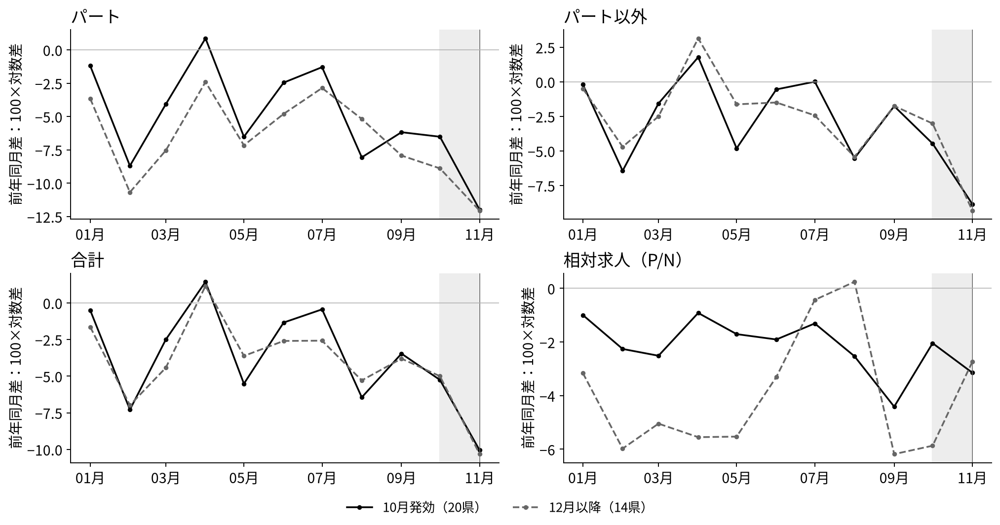
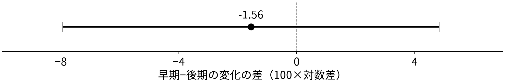

<!-- _class: title -->

# 最低賃金の発効時期と採用の構成

## 計算結果とモデルの照合

前回定めた方法で、早期・後期の変化の差を計算する。
求人全体の縮小と、パートに対する相対的な変化を読む。

2026年11月11日　ミクロ経済学セッション　課題4 SHEN MINGWEI・SUN SHAOHAN・WANG JING

<!-- notes: 前回は企業の採用選択モデルと統計的な比較方法を説明しました。今回は同じ群分けと基準期に沿って計算結果を示し、モデルの予測と照合します。仮定値を使うモデル例と実際の県別データの推定結果は明確に分けます。 -->

---

# 数えているのは、新しく受理された採用予定人員

| 系列 | 第12表の区分 | この発表での呼び方 |
|---|---|---|
| 一般パートタイム | 第12表－3 | パート（P） |
| パートを除く一般 | 第12表－2 | パート以外（N） |
| パートを含む一般 | 第12表－1 | 合計（P＋N） |

- 単位は人。広告の件数、実際の採用人数、雇用者数ではない。
- ハローワークの受理地別。勤務地別でも、全媒体の合計でもない。
- パートは所定労働時間による区分。パート以外は正社員だけではなく、非正規や臨時・季節の求人も含む。

使用表は2013年1月〜2026年8月、47都道府県で連続。主比較は2025年。原表の各月・各県でP＋N＝合計が成り立つ。

厚生労働省（2026a）第12表－1〜3、同省「集計結果（用語の解説）」(4)(5)(10)。

<!-- notes: まず人数の意味を固定します。求人が十人なら十件の広告という意味でも、十人が採用されたという意味でもありません。また、パート以外を正社員と読み替えるとモデルとデータの対応を誤ります。受理した県と実際の勤務地が一致するとも限りません。 -->

---

# 11月なら、発効済みと未発効を同じ月で比べられる

| 2025年度の発効時期 | 県数 | 2025年11月の適用状態 |
|---|---:|---|
| 10月発効：早期（E） | 20 | 全月が新最低賃金 |
| 11月発効 | 13 | 主比較から除外（前回と同じ規則） |
| 12月以降発効：後期（L） | 14 | 全月が旧最低賃金 |

同じ月・同じ統計・同じ前年同月比で比較し、県の規模に左右されないよう各県を等しく重み付けする。

それでも時期だけが違うわけではない。早期群は最低賃金水準が高く、引上げ率は低い（6.39% 対 7.78%）。

発効日の選択、需要の違い、発効前の先取り調整は残る。後期群は「政策を知らない群」ではなく、差はそのまま因果効果にはならない。

厚生労働省（2026b）；前回発表（2026-10-28）pp.2, 8。11月1日発効県も基準規則により除外。

<!-- notes: 11月を選ぶ利点は、二群の適用状態が月を通じて明確なことです。11月発効の十三県には一日発効も含まれますが、前回と同じ規則で除外します。この整理は比較を分かりやすくしますが、発効時期が無作為に決まったことを意味しません。 -->

---

<!-- _class: equations -->
# 前回のモデル：求人に関する条件付き予測

求人枠 $V_j$ のうち割合 $q_j$ が採用されると仮定する。

$$
H_j=q_jV_j,\qquad \frac{V_P}{V_N}=\frac{q_N}{q_P}\frac{H_P}{H_N}
$$

$q_P,q_N$ が一定なら、採用比の予測を求人比にも移せる。

| 条件付きの費用変化 | 求人合計 | P/N | N単独 |
|---|---|---|---|
| 両方が同じ率で上昇 | 減る | 不変 | 減る |
| Pだけが上昇 | 規模と構成が変わる | 下がる | 増減どちらも可 |

県集計への適用には、企業構成・需要・充足率・募集媒体が比較可能という追加条件が必要。現実のNにも最低賃金は適用される。費用差や充足率は本データから測れていない。

モデルと照合する指標：Pの早期−後期差は負か。さらに、合計とP/Nも見て、その差の形を記述する。

<!-- notes: 現実に見えるのは採用Hではなく募集Vです。充足率が変われば、採用の比が変わらなくても求人の比が変わりえます。モデルを県の統計に移すにはさらに企業構成などの条件が必要です。ここでの表は条件付き予測で、どの条件が現実に成立するかをこの統計だけで特定するものではありません。 -->

---

# 同じ相対費用変化でも、パート以外の方向は変わる

既存モデルの数値例：両費用1から $c_P=1.10,\ c_N=1.02$ へ。
$\sigma=2,\ a=0.5,\ B=2,\ q_P=q_N=1$ を固定する。

| 収入の曲率 | Pの変化 | Nの変化 | 合計の変化 | P/Nの変化 |
|---|---:|---:|---:|---:|
| $\beta=0.2$ | −14.80 | +0.30 | −6.96 | −15.10 |
| $\beta=0.7$ | −26.64 | −11.54 | −18.81 | −15.10 |

各欄は100×対数変化。仮定値による計算であり、2025年の推定ではない。

- 相対費用と代替弾力性が同じなので、P/Nの低下は同じ。
- 規模反応が大きい下段では、Nも減る。
- 上段のNはわずかに増えるが、合計は減っている。

results/model_illustration_NOT_ESTIMATED.csvの既存2行。analysis.pyのces_choiceで再計算。β以外の条件は同じ。

<!-- notes: これは実データではなく、既存の仮定値から二行を取り出した例です。前回のPだけの費用上昇の微分とは異なり、ここではNの費用も二パーセント上がっています。相対費用変化が同じなら比の変化は同じですが、規模反応を変えるとNの符号が変わることに注目してください。 -->

---

<!-- _class: equations -->
# 求人を、前年同月比・相対・比率に変換する

県 $i$、月 $t$、系列 $j=P,N,T$（$T=P+N$）について、

$$
y^j_{i,t}=100\left(\ln V^j_{i,t}-\ln V^j_{i,t-12}\right)
$$

人数ではなく増減率の近似。毎年繰り返す季節性をある程度抑える。

$$
y^R_{i,t}=y^P_{i,t}-y^N_{i,t}
=100\,\Delta_{12}\ln(V^P_{i,t}/V^N_{i,t})
$$

相対 $R$ は、PがNより強く減れば負になる。

$$
S_{i,t}=\frac{V^P_{i,t}}{V^P_{i,t}+V^N_{i,t}},\qquad
y^S_{i,t}=100(S_{i,t}-S_{i,t-12})
$$

$\Delta_{12}$ は前年同月との差。比率変化 $y^S$ の単位はポイント。
水準のP/NとSは単調に対応するが、差分・県平均の後は同値ではない。同じ原系列の補助指標で、独立の証拠ではない。

<!-- notes: 前年同月比は通常の増減率と完全に同じではなく対数差の百倍です。相対指標はPの前年同月比からNの前年同月比を引きます。一方、比率は全体に占めるPの割合の前年差です。水準の単調な関係を理由に、差分や平均の後も同じ推定量だとは言えません。 -->

---

<!-- _class: equations -->
# パートのDID係数は、早期−後期の変化の差

$Y_{i0}^P$ は1〜9月の平均同比、$Y_{i1}^P$ は11月の同比。
$\mathrm{Treat}_i$ は早期県で1、後期県で0。$\mathrm{Post}_t$ は後期だけ1。

$$
Y_{it}^P=\alpha^P+\beta^P\mathrm{Treat}_i+\gamma^P\mathrm{Post}_t
+\delta^P(\mathrm{Treat}_i\times\mathrm{Post}_t)+\varepsilon_{it}^P
$$

| パート：実際の群平均 | 1〜9月の平均 | 11月 | 県内変化の平均 |
|---|---:|---:|---:|
| 早期20県（E） | −4.182 | −11.990 | −7.809 |
| 後期14県（L） | −5.804 | −12.057 | −6.253 |
| 早期−後期 | +1.622 | +0.066 | **−1.555** |

各県等重みの交互作用係数は $\widehat{\delta}^P=\bar d_E^P-\bar d_L^P$、
約−1.56。$d_i^P=Y_{i1}^P-Y_{i0}^P$ は県内変化を表す。

主仮説は $H_0:\delta^P\geq0$、$H_1:\delta^P<0$。従来のWelch方式で片側検定を行い、両側95%区間を併記する。

results/group_means.csv、contrasts.csv（基準期2025-09）。既存の平均差をDID係数として表記。因果効果とは解釈しない。

<!-- notes: 前回示した標準DID式を、パートの同比に当てはめます。一県に前期と後期の二観測を置き、各県を同じ重みで扱います。後期群の前期平均がアルファ、前期の群間差がベータ、後期群の変化がガンマです。早期群の変化はマイナス七・八一、後期群はマイナス六・二五なので、交互作用デルタの推定値は約マイナス一・五六です。これは従来の平均変化の差と同じ値で、再推定はしていません。表は丸め表示で、元の計算は非丸め値です。県内差を使うWelch推論を維持し、同じ県の二時点を独立とは扱いません。平行トレンドなどの条件を確認した因果効果とは解釈しません。 -->

---

# 月ごとの動きは似た部分もあるが、重なってはいない

横軸：2025年の月。縦軸：前年同月比（100×対数差）、相対はP−N。実線は早期、破線は後期の県単純平均。灰色は10月、縦線は11月。P・N・合計は10月から11月に低下するが、共同変動だけでは政策効果や平行トレンドを確認できない。

厚生労働省（2026a）から作成。10月は主比較月に含めない。出所・原系列はsources.md。

<!-- notes: 四つの図は同じ月と同じ二群を使います。まず左上のパートを見て、両群とも十一月に低下していることを確認します。その共通した低下そのものではなく、前頁で計算した差の変化を比べます。右下の相対系列は人数の合計ではなくPとNの前年同月比の差です。 -->

---

# パートの主比較は負だが、負の差を確認する精度がない

点は回帰係数 $\widehat{\delta}^P=-1.56$、横線はWelchの95%区間 $[-7.93,\ 4.82]$。
左側は早期群の相対的な低下、右側は相対的な上昇を表す。

- 主係数の負方向の片側 $p=0.310$。通常の5%水準で棄却できない。
- 区間は負も正も含むため、負の差を明確には確認できない。
- 「影響がない」の証明ではなく、差の大きさも方向も絞れていない。

主値 −1.555410、Welch95% [−7.933878, 4.823057]、片側p=0.310082。県独立の記述的近似で、因果の区間ではない。

<!-- notes: パートの回帰係数の点推定は前回の仮説と同じ方向です。しかし横線がゼロをまたぎ、比較的大きいマイナスもプラスも含みます。負方向の片側検定でも棄却できません。この結果を効果なしと呼ばず、負の差を確かめるには証拠が足りないと読みます。 -->

---

# 合計と構成を足しても、機序は絞り切れない

| 追加の指標 | 回帰係数 | Welch 95%区間 | 読み方 |
|---|---:|---:|---|
| パート以外 | +0.67 | [−3.02, 4.37] | 増加も減少もありうる |
| 合計 | −0.15 | [−4.15, 3.85] | 規模縮小も排除できない |
| 相対（P−N） | −2.23 | [−8.05, 3.59] | Pが相対的に弱い点推定 |
| パート比率（ポイント） | −0.51 | [−1.85, 0.82] | 同じ原系列の補助指標 |

- 合計の点がほぼ0でも、負の差を区間が含む。共通の費用上昇による規模縮小を否定できない。
- 相対の負はP費用上昇の予測と方向が合うが、区間は0を含む。
- Nがプラスでも、企業内で代替した証拠にはならない。

同じ県・同じ重みの回帰では、相対の係数 −2.23＝−1.56−0.67 は計算上の恒等式。相対の区間は県内のP・Nの共分散を使うため、区間の端点を単純に引いて作らない。

results/contrasts.csv、基準期2025年1〜9月。相対の片側p=0.220。モデルの条件付き予測はp.4。

<!-- notes: 被説明変数を非パート、合計、相対、比率に替えた回帰係数を整理します。合計の点推定はゼロに近いのですが、区間はマイナス四程度まで含みます。相対は負でもゼロを含みます。どちらの経路も排除できないので、構成変化が起きたという強い結論には進みません。恒等式が成り立つことは経済仮説の支持ではありません。 -->

---

# 基準期を早めても、結論は強くならない

8〜9月には改定額公表後の先取り調整がありうるため、
1〜7月を基準にした結果も、元の1〜9月基準と併記する。

| 指標 | 1〜9月基準：係数 [95%区間] | 1〜7月基準：係数 [95%区間] |
|---|---:|---:|
| パート | −1.56 [−7.93, 4.82] | −2.18 [−8.85, 4.49] |
| 合計 | −0.15 [−4.15, 3.85] | −0.38 [−4.65, 3.88] |
| 相対 | −2.23 [−8.05, 3.59] | −2.89 [−8.90, 3.12] |

係数はより負になるが、どの区間も0を含む。主基準を入れ替えない。

前年同月比は2024年度改定の影響も差し引く。発効時期と引上げ幅、産業・県の需要が異なり、基準期を変えても因果解釈の問題は解消しない。

results/contrasts.csv（2025-09と2025-07）。事前に定めた感度分析で、符号や有意性を見て月・群を選び直していない。

<!-- notes: 前回の講稿でも公表後の期間を基準から外す比較を予定していました。その確認をしたものです。点は負方向に動きますが精度不足という結論は変わりません。一から七月を使えば完全な未処理期間になると保証するわけでもなく、前年政策や期待の問題は残ります。 -->

---

# 分かったことと、次に観測したいこと

- パートの回帰係数は−1.56。合計は−0.15、相対は−2.23だが、すべての区間が0を含む。負の差や規模縮小の有無を確定できない。
- CESモデルは、Nにも代替と規模縮小が及ぶことを示す。Nは正社員だけではなく、「未処理群」でもない。
- 求人だけの低下を雇用の減少と読まない。補充需要、充足率、募集媒体の変化でも求人は動く。新規部門・既存従業員なしというモデルの限界もある。

含意：パートだけで政策を評価せず、合計と相対を併記する。ただし、モデルを豊かにしても、同じ比較の証拠が強くなるわけではない。

次に必要なのは、求人票の職種・賃金帯、企業内の募集構成、実際の採用・充足の情報。これらで条件を確かめて初めて、代替と規模縮小の区別に近づける。

<!-- notes: 本報告の結論は、パートが守られたとも、構成だけが変わったとも言えないということです。一方で、パート以外を対照にすればよいという読み方を、モデルから退けられます。今後は同じ弱い比較に理論を足すだけでなく、費用や企業内の募集と充足に関する情報を集める必要があります。 -->

---

<!-- _class: refs -->
# 参考文献・データ

Acemoglu, D. and D. Autor (2011), “Skills, Tasks and Technologies: Implications for Employment and Earnings,” *Handbook of Labor Economics* 4B, ch.12, pp.1043–1171（刊行章；使用箇所pp.1103–1105）. [本文PDF](https://economics.mit.edu/sites/default/files/publications/Skills%2C%20Tasks%20and%20Technologies%20-%20Implications%20for%20.pdf)

Ohta, S. and K. Komae (2022), “Vacancies, Job Seekers, and Minimum Wages: Evidence from Public Employment Placement Service Data,” Keio-IES DP2022-004（2022年3月DP版）, 4.3節・Table 5. https://ies.keio.ac.jp/upload/DPEN_7694_202203091453351.pdf

Kanayama, H., S. Miyaji and S. Otani (2026), “Just After Minimum Wage Hikes: Short-Run Labor-Demand Response and Reallocation,” arXiv v3. https://arxiv.org/pdf/2505.04555v3

Kazekami, S. and M. Abe (2025), “Effects of minimum wage changes on labor demand: analysis using job postings data,” *Applied Economics*（2025年11月14日online版）. https://doi.org/10.1080/00036846.2025.2579945

厚生労働省（2026a）「一般職業紹介状況 長期時系列表 第12表 都道府県（受理地）別 雇用形態別 新規求人数」（2026年10月26日取得）. [e-Stat Excel](https://www.e-stat.go.jp/stat-search/file-download?statInfId=000040505323&fileKind=0)

厚生労働省（2026b）「地域別最低賃金改定状況」（同日取得）. https://www.mhlw.go.jp/content/11200000/001756130.xlsx 同省「令和7年度 地域別最低賃金額一覧」p.3. https://www.mhlw.go.jp/content/11201250/001729623.pdf 同省「集計結果（用語の解説）」. https://www.mhlw.go.jp/toukei/list/114-1_yougo.html

<!-- notes: データと文献の出所です。CESは刊行章の該当ページ、求人類型別の推定は太田・小前のDP版を参照しています。原文で確かめた範囲と、本報告で追加した仮定の区別はsourcesとmethodsにも残しています。 -->
