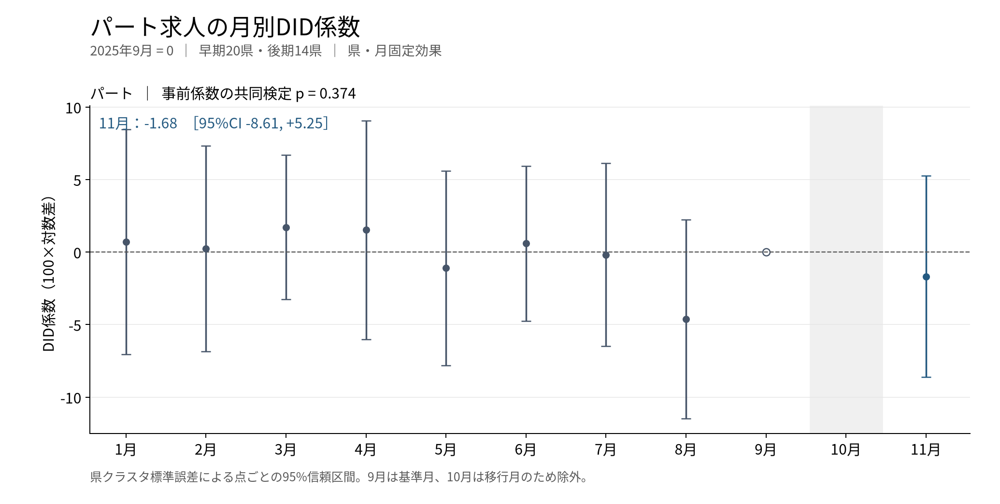

# 月度 DID：2025 年最低工资与求人

当前主分析，沿用 20 个早期生效县、14 个后期生效县，使用 **2025 年 1–9 月和 11 月，共 340 个县×月观测**。对应[11月4日的方法稿](../../2026-11-04/README.md)；旧两期DID与Welch结果保存在[归档目录](../../archive/2026-11-11-two-period-did/README.md)，供对照。

**兼职求人 DID 为 −1.56，县聚类标准误为 3.26，95% 置信区间为 [−8.18, 5.07]。** 点估计与原版一致。月度展开增加了事前趋势信息；本次观察窗口相同，估计精度没有提高。

## 回归与主要结果

$$
Y_{it}^{j}=\alpha_i^{j}+\lambda_t^{j}
+\delta^{j}(Treat_i\times Post_t)+\varepsilon_{it}^{j}.
$$

每一行是一县一月。加入县固定效应和月份固定效应；早期县的 Treat = 1，11 月的 Post = 1。10 月为移行月，排除。标准误按县聚类。

| 指标 | DID 系数 | 聚类 SE | 95% CI | 事前联合检验 p |
|---|---:|---:|---:|---:|
| 兼职求人 P | −1.56 | 3.26 | [−8.18, 5.07] | 0.374 |
| 非兼职求人 N | +0.67 | 1.86 | [−3.11, 4.46] | 0.156 |
| 合计求人 T | −0.15 | 2.01 | [−4.25, 3.95] | 0.579 |
| 相对求人 R = P − N | −2.23 | 3.00 | [−8.32, 3.87] | 0.068 |
| 兼职占比 S | −0.51 | 0.69 | [−1.91, 0.89] | 0.070 |

P、N、T 使用求人量的前年同月对数差 ×100；R 为 P 与 N 的同比差；S 为占比的前年同月差，单位为百分点。主 DID 比较 11 月与 1–9 月平均。事前联合检验来自下面的月度交互项回归。

兼职的事前系数联合检验未拒绝零假设。相对求人和兼职占比的 p 值接近 0.07，在 10% 水平拒绝；这两个构成指标需要进一步检查政策前走势。

## 月度系数图

图以 **9 月为基期**，11 月系数为 −1.68；上表以 **1–9 月平均为基期**，系数为 −1.56。两者基期不同。空心点是归一化为 0 的 9 月，误差棒为点估计的 95% 置信区间。

[四项指标的月度系数图](assets/monthly_did_all.png) · [早晚两组的月度趋势图](assets/monthly_trends.png)

## 与原版对照

| 兼职求人 | 原版：前期均值与 11 月 | 本版：月度固定效应回归 |
|---|---:|---:|
| DID 系数 | −1.56 | −1.56 |
| 标准误 | 3.10（Welch） | 3.26（县聚类 CRV1） |
| 95% CI | [−7.93, 4.82] | [−8.18, 5.07] |

相同样本和等权口径下，两种写法的点估计相同。区间差异来自标准误及自由度的处理。

沿用既定的 **1–7 月基准期敏感性分析**，兼职 DID 为 −2.18，聚类 SE 为 3.44，95% CI 为 [−9.19, 4.83]。本版政策后月份仍为 11 月。

## 文件与复现

- [parallel_trends.md](parallel_trends.md)：从本周移入的平行趋势说明、月度交互项和事前联合检验，供下周发表使用。
- [methods.md](methods.md)：回归式、事前检验、标准误和数据来源。
- [did_estimates.csv](results/did_estimates.csv)：主分析、1–7 月敏感性分析及原版对照。
- [monthly_coefficients.csv](results/monthly_coefficients.csv)：五个指标的月度系数，附 9 月基期及前期均值归一化两种口径。
- [pretrend_tests.csv](results/pretrend_tests.csv)：事前系数联合检验。
- [monthly_panel.csv](results/monthly_panel.csv)：实际进入主回归的 340 行面板。

在仓库根目录，以装有 [requirements.txt](requirements.txt) 依赖的 Python 运行：

~~~bash
python 2026-11-11/analysis/analysis.py
python 2026-11-11/analysis/verify.py
~~~

本机已在仓库缓存中准备好环境，可将 python 替换为 .cache/monthly-did-venv/bin/python。分析程序只读归档中已核验的输入CSV和字体，所有分析输出写入本目录；输入位置详见[methods.md](methods.md)。

[verification.json](verification.json) 记录原始Excel、独立DID系数、县聚类标准误和事前联合检验的复核结果。本次目录整理的迁移与文件哈希见[归档清单](../../archive/reorganization_2026-11-04.json)。
