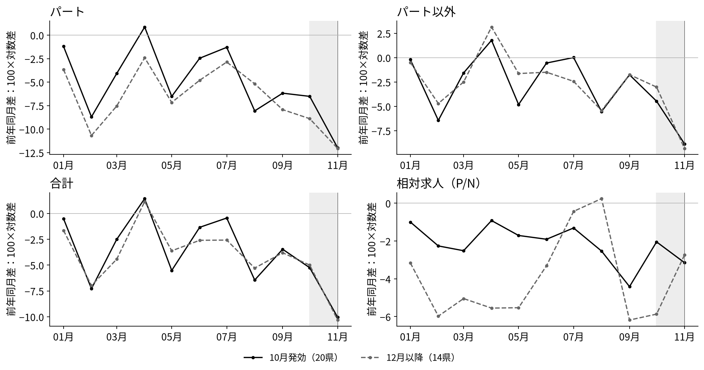
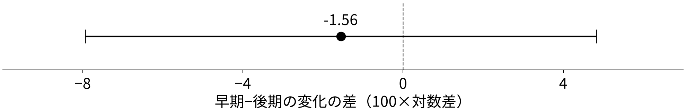

<!-- _class: title -->

# 最低賃金の発効時期と採用の構成

## 計算結果とモデルの照合

前回定めた方法で、早期・後期の変化の差を計算する。
求人全体の縮小と、パートに対する相対的な変化を読む。

2026年11月11日　ミクロ経済学セッション　課題4 SHEN MINGWEI・SUN SHAOHAN・WANG JING

<!-- notes: 前回は企業の採用選択モデルと統計的な比較方法を説明しました。今回は同じ群分けと基準期に沿って計算結果を示し、モデルの予測と照合します。仮定値を使うモデル例と実際の県別データの推定結果は明確に分けます。 -->

---

# データ：ハローワークの新規求人数

| 系列 | 第12表の区分 | この発表での呼び方 |
|---|---|---|
| 一般パートタイム | 第12表－3 | パート（P） |
| パートを除く一般 | 第12表－2 | パート以外（N） |
| パートを含む一般 | 第12表－1 | 合計（P＋N） |

- 各月に受理した採用予定人数を、都道府県別に集計する。
- パートは所定労働時間で区分し、P＋Nを求人合計とする。

収録期間：2013年1月〜2026年8月、47都道府県。主比較は2025年。

厚生労働省（2026a）第12表－1〜3、同省「集計結果（用語の解説）」(4)(5)(10)。

<!-- notes: 使うデータはハローワークが受理した新規求人の人数です。パートをP、パート以外をNとし、両者を足した合計も見ます。 -->

<!-- qa: Q：求人数と採用・雇用は同じか。
A：新規求人数は採用予定人数です。実際に採用できた人数や雇用者数は別の指標です。

Q：Nは正社員を意味するか。
A：Nはパートを除く一般求人で、非正規や臨時・季節の求人も含みます。集計地域はハローワークの受理地です。 -->

---

# 11月なら、発効済みと未発効を同じ月で比べられる

| 2025年度の発効時期 | 県数 | 2025年11月の適用状態 |
|---|---:|---|
| 10月発効：早期（E） | 20 | 全月が新最低賃金 |
| 11月発効 | 13 | 主比較から除外 |
| 12月以降発効：後期（L） | 14 | 全月が旧最低賃金 |

早期20県と後期14県について、基準期から11月までの変化を比べる。
各県は同じ重みで集計する。

厚生労働省（2026b）；前回発表（2026-10-28）pp.2, 8。11月1日発効県も基準規則により除外。

<!-- notes: 比較するのは早期二十県と後期十四県です。十一月発効の十三県を除き、各県を同じ重みで扱います。 -->

<!-- qa: Q：二群は時期以外も似ているか。
A：早期群は最低賃金水準が高く、引上げ率は6.39%と後期群の7.78%より低いです。需要や先取り調整の違いもあり、比較は平均変化の差として扱います。11月1日発効県も統一ルールで除外しています。 -->

---

<!-- _class: equations -->
# モデルの比較静学：求人の規模と構成

求人充足率を $q_j$ とすると、採用人数と求人数の関係は

$$
H_j=q_jV_j,\qquad \frac{V_P}{V_N}=\frac{q_N}{q_P}\frac{H_P}{H_N}
$$

求人充足率が一定なら、相対労働需要の予測を相対求人数にも適用できる。

| 費用の変化 | 求人合計 | P/N | N単独 |
|---|---|---|---|
| 両方が同じ率で上昇 | 減少 | 不変 | 減少 |
| Pだけが上昇 | 規模・構成の調整 | 低下 | 符号は不定 |

主仮説：パートのDID係数は負。合計と相対指標で、規模効果・構成変化と照合する。

<!-- notes: 求人充足率qを一定と仮定し、労働需要の比較静学を求人の予測に接続します。主仮説はパートのDID係数が負であることです。合計と相対指標も併記し、規模効果と構成変化の予測と照合します。 -->

<!-- qa: Q：企業モデルの予測を県別データに移す条件は何か。
A：充足率に加え、企業構成、需要、募集媒体などの比較可能性が必要です。充足率が変われば採用が同じでも求人は変わります。現実にはNにも最低賃金が適用され、費用差と充足率は本データから直接測れていません。 -->

---

# 数値例：代替効果と規模効果の比較

仮定値による例：両費用1から $c_P=1.10,\ c_N=1.02$ へ。
$\sigma=2,\ a=0.5,\ B=2,\ q_P=q_N=1$ を固定する。

| 収入の曲率 | Pの変化 | Nの変化 | 合計の変化 | P/Nの変化 |
|---|---:|---:|---:|---:|
| $\beta=0.2$ | −14.80 | +0.30 | −6.96 | −15.10 |
| $\beta=0.7$ | −26.64 | −11.54 | −18.81 | −15.10 |

各欄は100×対数変化。β以外の条件をそろえた比較。

- 相対費用と代替弾力性が同じなので、P/Nの低下は同じ。
- 規模効果が大きい下段では、Nの労働需要も減少する。

results/model_illustration_NOT_ESTIMATED.csv。仮定値によるモデル計算。

<!-- notes: 相対費用と代替弾力性を固定し、収入関数の曲率を変えた比較静学の数値例です。相対労働需要の変化は同じですが、規模効果が大きい下段ではNの労働需要も減少します。 -->

<!-- qa: Q：これは2025年の推定結果か。
A：モデルの仮定値による計算例です。両費用を1からPは1.10、Nは1.02へ変えています。Pだけの費用上昇を考えた微分とは条件が異なります。 -->

---

<!-- _class: equations -->
# アウトカム変数：前年同月比と求人構成

県 $i$、月 $t$、系列 $j=P,N,T$（$T=P+N$）について、

$$
y^j_{i,t}=100\left(\ln V^j_{i,t}-\ln V^j_{i,t-12}\right)
$$

対数差×100で、前年同月からの変化率を近似する。

$$
y^R_{i,t}=y^P_{i,t}-y^N_{i,t}
=100\,\Delta_{12}\ln(V^P_{i,t}/V^N_{i,t})
$$

相対指標 $R$ は、Pの増加率がNを下回ると負になる。

$$
S_{i,t}=\frac{V^P_{i,t}}{V^P_{i,t}+V^N_{i,t}},\qquad
y^S_{i,t}=100(S_{i,t}-S_{i,t-12})
$$

$\Delta_{12}$ は前年同月との差。$y^S$ はパート比率の前年差（ポイント）。

<!-- notes: まず前年同月比で各系列の動きを見ます。PからNを引いた相対指標は、パートの伸びが非パートより低いと負になります。最後のSは求人合計に占めるパートの比率で、その前年差をポイントで表します。 -->

<!-- qa: Q：P/Nとパート比率Sは同じ指標か。
A：水準では単調に対応しますが、差分や県平均の後は同じ推定量にはなりません。同じ原系列から作る補助指標なので、独立した追加証拠とは数えません。前年同月比は100×対数差で、通常の変化率の近似です。 -->

---

<!-- _class: equations -->
# DID推定：群平均と交互作用係数

$Y_{i0}^P$ は前年同月比の1〜9月平均、$Y_{i1}^P$ は11月の前年同月比。
処置群ダミー $\mathrm{Treat}_i$ は早期県で1、事後ダミー $\mathrm{Post}_t$ は後期で1。

$$
Y_{it}^P=\alpha^P+\beta^P\mathrm{Treat}_i+\gamma^P\mathrm{Post}_t
+\delta^P(\mathrm{Treat}_i\times\mathrm{Post}_t)+\varepsilon_{it}^P
$$

| パート：実際の群平均 | 1〜9月の平均 | 11月 | 県内変化の平均 |
|---|---:|---:|---:|
| 早期20県（E） | −4.182 | −11.990 | −7.809 |
| 後期14県（L） | −5.804 | −12.057 | −6.253 |
| 早期−後期 | +1.622 | +0.066 | **−1.555** |

各県等重みの交互作用係数は $\widehat{\delta}^P=\bar d_E^P-\bar d_L^P$、
約−1.56。$d_i^P=Y_{i1}^P-Y_{i0}^P$ は県内変化を表す。

主仮説：$H_0:\delta^P\geq0$、$H_1:\delta^P<0$。Welchの片側検定を用いる。

results/group_means.csv、contrasts.csv。基準期は2025年1〜9月。

<!-- notes: 早期群の平均変化はマイナス七・八一、後期群はマイナス六・二五です。この差である約マイナス一・五六が、交互作用項の係数、すなわちDID推定値です。 -->

<!-- qa: Q：回帰にして再推定したか。
A：同じ標本、基準期、県等重みなら前の平均差と代数的に一致するため、既存数値をそのまま使っています。表は丸め表示です。

Q：この係数を政策の因果効果と読めるか。
A：平行トレンドなどを確認した因果効果とは解釈していません。県内差を使うWelch推論で、同じ県の二時点を独立には扱いません。 -->

---

# 月別推移：11月は両群で前年同月比が低下

横軸は2025年の月、縦軸は前年同月比（100×対数差）。相対はP−N。実線は早期、破線は後期の県平均。灰色は10月、縦線は11月。

厚生労働省（2026a）から作成。10月は主比較月に含めない。出所・原系列はsources.md。

<!-- notes: パート、パート以外、合計の前年同月比は、両群とも十月から十一月に低下しています。DIDでは、この共通の動きに加えて、二群の変化がどれだけ違うかを見ます。 -->

<!-- qa: Q：この図で平行トレンドを確認できるか。
A：同じ方向に動いているだけでは十分ではありません。政策前の複数月の動きを確認する必要があります。 -->

---

# パートのDID推定値と95%信頼区間

点はDID推定値 $\widehat{\delta}^P=-1.56$、横線はWelchの95%信頼区間 $[-7.93,\ 4.82]$。
左側は早期群の相対的な低下、右側は相対的な上昇を表す。

負方向の片側 $p=0.310$。有意水準5%では統計的に有意でない。

results/contrasts.csv。県内差に基づくWelch標準誤差・自由度を使用。

<!-- notes: パートのDID推定値は負ですが、95%信頼区間はゼロを含みます。片側p値は〇・三一で、有意水準五パーセントでは統計的に有意でないという結果です。 -->

<!-- qa: Q：有意でないなら影響はゼロか。
A：ゼロと確認したわけではありません。区間は負と正の両方を含み、このデータでは差の大きさと方向を十分に絞れていません。片側検定と両側95%区間の判定も同一ではありません。 -->

---

# 合計の点推定は0付近、相対は負方向

| 追加の指標 | 回帰係数 | Welch 95%信頼区間 | 解釈 |
|---|---:|---:|---|
| パート以外 | +0.67 | [−3.02, 4.37] | 点推定は正方向 |
| 合計 | −0.15 | [−4.15, 3.85] | 点推定は0付近 |
| 相対（P−N） | −2.23 | [−8.05, 3.59] | Pが相対的に弱い点推定 |
| パート比率（ポイント） | −0.51 | [−1.85, 0.82] | 同じ原系列の補助指標 |

相対指標は、Pの費用上昇というモデルの予測と方向が一致する。
各指標の95%信頼区間は、いずれも0を含む。

results/contrasts.csv、基準期2025年1〜9月。相対の片側p=0.220。モデルの条件付き予測はp.4。

<!-- notes: 合計の点推定はゼロに近く、相対指標はマイナス二・二三です。相対指標の方向はモデルの予測と合っていますが、各区間はゼロを含みます。 -->

<!-- qa: Q：合計が0付近なら規模縮小はないか。
A：合計の区間はマイナス四程度まで含むため、規模縮小もデータと整合します。Nの正の点推定だけで企業内代替を確認したとも言えません。

Q：相対の係数と区間はどう作るか。
A：同じ標本と重みでは、相対の係数はPの係数からNの係数を引いた値です。分散には県内のPとNの共分散が入るので、区間端点を引き算して作りません。 -->

---

# 感度分析：基準期を1〜7月に変更

先取り効果を考慮して公表後の8〜9月を除き、基準期を1〜7月とする。
各欄は点推定値［95%信頼区間］。

| 指標 | 1〜9月基準 | 1〜7月基準 |
|---|---:|---:|
| パート | −1.56 [−7.93, 4.82] | −2.18 [−8.85, 4.49] |
| 合計 | −0.15 [−4.15, 3.85] | −0.38 [−4.65, 3.88] |
| 相対 | −2.23 [−8.05, 3.59] | −2.89 [−8.90, 3.12] |

点推定値はより負になる。95%信頼区間は、どちらの基準でも0を含む。

results/contrasts.csv。主基準：1〜9月。感度分析：1〜7月。

<!-- notes: 先取り効果を考慮した基準期の感度分析です。一月から七月を基準にすると点推定値はより負になりますが、両方の仕様で95%信頼区間はゼロを含みます。 -->

<!-- qa: Q：なぜこの基準期を追加したか。
A：公表後の先取り調整を考慮し、前回から予定した感度分析です。結果に応じて主基準を入れ替えていません。前年政策、期待、需要や引上げ幅の違いは別途残ります。 -->

---

# 結論と今後の課題

- DID推定値はパート−1.56、合計−0.15、相対−2.23。95%信頼区間はいずれも0を含む。
- モデルの代替効果・規模効果を用いて、求人の構成変化と規模調整を解釈する。

今後は、職種・賃金帯、企業内の募集構成、採用実績と求人充足率を分析する。

<!-- notes: DID推定値はパートと相対指標が負、合計がゼロ付近でした。95%信頼区間はいずれもゼロを含みます。今後は企業内の募集、採用実績、求人充足率の情報を加え、代替効果と規模効果を検討します。 -->

<!-- qa: Q：今回どこまで結論づけられるか。
A：早期・後期の平均変化の差と、その不確実性を整理した段階です。構成だけが変わった、規模縮小がなかった、雇用が減ったとは確定していません。モデルの充足率一定や新設部門という条件も、追加データで確かめる必要があります。 -->

---

<!-- _class: refs -->
# 参考文献・データ

Acemoglu, D. and D. Autor (2011), “Skills, Tasks and Technologies: Implications for Employment and Earnings,” *Handbook of Labor Economics* 4B, ch.12, pp.1043–1171（刊行章；使用箇所pp.1103–1105）. [本文PDF](https://economics.mit.edu/sites/default/files/publications/Skills%2C%20Tasks%20and%20Technologies%20-%20Implications%20for%20.pdf)

Ohta, S. and K. Komae (2022), “Vacancies, Job Seekers, and Minimum Wages: Evidence from Public Employment Placement Service Data,” Keio-IES DP2022-004（2022年3月DP版）, 4.3節・Table 5. https://ies.keio.ac.jp/upload/DPEN_7694_202203091453351.pdf

Kanayama, H., S. Miyaji and S. Otani (2026), “Just After Minimum Wage Hikes: Short-Run Labor-Demand Response and Reallocation,” arXiv v3. https://arxiv.org/pdf/2505.04555v3

Kazekami, S. and M. Abe (2025), “Effects of minimum wage changes on labor demand: analysis using job postings data,” *Applied Economics*（2025年11月14日online版）. https://doi.org/10.1080/00036846.2025.2579945

厚生労働省（2026a）「一般職業紹介状況 長期時系列表 第12表 都道府県（受理地）別 雇用形態別 新規求人数」（2026年10月26日取得）. [e-Stat Excel](https://www.e-stat.go.jp/stat-search/file-download?statInfId=000040505323&fileKind=0)

厚生労働省（2026b）「地域別最低賃金改定状況」（同日取得）. https://www.mhlw.go.jp/content/11200000/001756130.xlsx 同省「令和7年度 地域別最低賃金額一覧」p.3. https://www.mhlw.go.jp/content/11201250/001729623.pdf 同省「集計結果（用語の解説）」. https://www.mhlw.go.jp/toukei/list/114-1_yougo.html

<!-- notes: データと文献の出所です。CESは刊行章の該当ページ、求人類型別の推定は太田・小前のDP版を参照しています。原文で確かめた範囲と、本報告で追加した仮定の区別はsourcesとmethodsにも残しています。 -->
